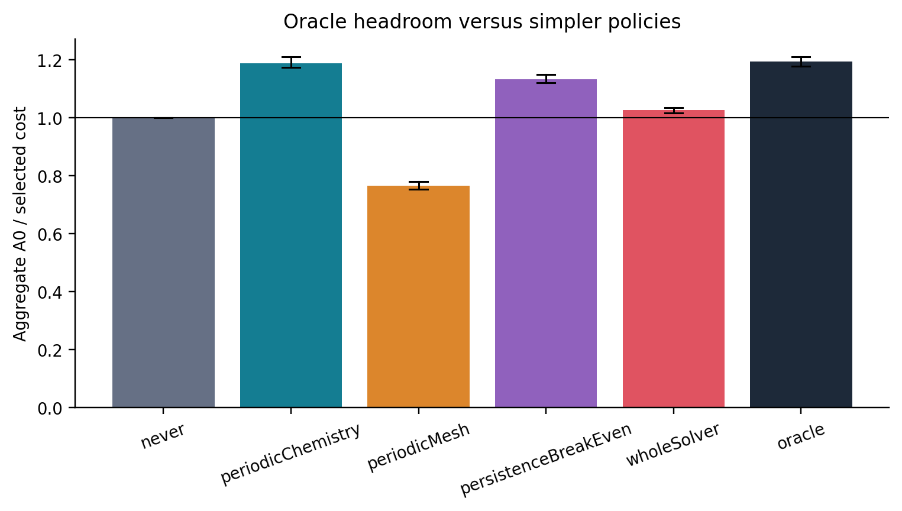

# Reactive-flow action oracle for OpenFOAM

Can a runtime selector choose between unchanged ownership, chemistry tasks, mesh redistribution and a hybrid to minimize **total simulation wall time** on unseen operating conditions?

Chemistry imbalance offers an opportunity, but an action also changes startup, transport, pressure, communication and migration costs. This artifact measures those consequences before evaluating a predictor. The strongest directly executed chemistry baseline is the pinned Stuttgart implementation, ported narrowly to the same OpenCFD v2012 installation.

Start with the generated [research summary](docs/research_summary.md), [paper-style report](docs/final_report.md), [summary tables](tables/summary.md), and [highlight figures](figures/highlights/). Exact headline values and uncertainty are regenerated in [headline.json](data/processed/headline.json). The complete figure index supplies captions and source data.

<!-- measured-results-start -->
## Measured results

Held-out replay: always-AC 1.190×, mesh-only 0.767×, frozen whole-cost selector 1.027×, hindsight oracle 1.195×. The oracle offers only 0.43% extra headroom above the strong chemistry action.

Independent moving-condition AC confirmation: 1.361×, 95% within-condition bootstrap interval [1.345, 1.396], twenty trials per action, four bound ranks, 256 cells, 160 μs future interval, global dt=2 μs, complete action and continuation process costs.

Actual held-out live controller: 0.922× [0.895, 0.942] relative to uninterrupted native chemistry, including preprocessing, decomposition and every controller startup/action. Uninterrupted Stuttgart baseline: 1.209×. The report distinguishes field equivalence from physical conservation/refinement limitations.


<!-- measured-results-end -->

## What is implemented

| Action | Implementation | Costs charged |
|---|---|---|
| A0 | Native ownership; standard ODE loop with passive cell clocks | Complete continuation process wall |
| AC | Compatible upstream chemistry-task redistribution | Scheduling/communication inside the solver, startup and endpoint I/O |
| AM | Measured weights and native `redistributePar -overwrite` | Weight construction, configuration, redistribution process, subsequent solver wall |
| AH | AM followed by AC | Both sets of costs |

The interpretable ridge controller uses only current/past clocks, adds measured action costs and a conservative prediction-error margin, supports no action, and has a forty-step cooldown. Entire conditions are split into training, validation and test. Both independent checkpoint deployment and actual sequential live rollouts charge controller overhead.

The benchmark uses global physical timesteps and checks the actual endpoint on every rank. Restart initialization restores solved enthalpy and static-mesh pressure-history state, and preallocates the previous compressibility coefficient before updating thermodynamics. A separate opt-in executable exercises the same state-preserving path for live rollouts. Canonical migrated cell IDs prevent confusing reordered fields with numerical differences. Mass/element/energy inventories and refinement diagnostics distinguish algorithmic equivalence from physical accuracy.

Separate diagnostics identify an initial `psi.oldTime` mass offset and loss of eight cyclic face-flux copies during one repeated migration. The initialization-only executable and [flux preservation utility](docs/flux_preservation.md) provide bounded correctness controls. The original failed mesh trial remains rejected in the performance data. These utilities do not establish physically converged flames or a new controller gain.

## Scope of the evidence

The main oracle has 25 states × four actions × five trials = 500 continuations on ten controlled periodic reactive-flow conditions. Supplemental studies cover horizons, weighting strengths, profiler perturbation, 512-cell scaling at 1/2/4/6 physical cores, finer timesteps, independent twenty-trial replications, and a public QUICKLB library kernel.

These are small, coarse reacting kernels on one six-core Ryzen 5600X WSL2 host. They are not validated burner models, resolved flames or a multi-node HPC scaling demonstration. The report shows every action and negative result. No new partitioner, chemistry-offloading principle, persistence principle or adaptive trigger is claimed. The novelty challenge and primary-source ledger explain the narrow defensible contribution.

## Build and smoke test

Commands below run from `research/physicsAwareDecomposition` on Linux/WSL. OpenCFD v2012, its build tools, MPI and Python are prerequisites. The local installation uses GCC 6.3 and a user-space sysroot; [compilerEnv.sh](../scripts/compilerEnv.sh) contains that adapter. Native installations can override `PAD_COMPILER_PATH`, `PAD_SYSROOT`, and `PAD_FOAM_ROOT`. No system OpenFOAM source is modified.

```bash
bash actionStudy/scripts/setup.sh
bash actionStudy/scripts/build.sh
bash actionStudy/scripts/buildRestart.sh
bash actionStudy/scripts/buildInventory.sh
bash actionStudy/scripts/buildMPI.sh
bash actionStudy/scripts/buildRedistributor.sh
bash actionStudy/scripts/buildFluxAudit.sh
bash actionStudy/scripts/buildFluxState.sh
bash actionStudy/scripts/reproduce.sh smoke
```

The default runs unit tests plus fresh four-action MPI endpoint and repeated cyclic-migration regressions. The private v2012 redistribution utility corrects its processorCyclic validation check; the installed utility is preserved. It retains its temporary directory. Cases refuse to overwrite existing experiments.

```bash
# Bounded two-condition pilot, eight continuations:
PAD_ACTION_ROOT=/tmp/pad-action-small bash actionStudy/scripts/reproduce.sh small
# Full bounded local campaign, in a fresh directory:
export PAD_ACTION_ROOT=/tmp/pad-action-full
bash actionStudy/scripts/reproduce.sh full
python3 actionStudy/scripts/finish.py
```

The recorded execution pilots establish seconds-to-minutes per case rather than launching an unbounded allocation. The full local study takes substantially longer and writes many small case files. No default command submits cluster jobs. A portable example allocation is provided separately for hosts with Slurm.

## Analysis and plots

After a complete campaign, run `finish.py` with the same `PAD_ACTION_ROOT` to generate the independent confirmations, explanatory models, inventories, QUICKLB QA, clean build checks, figures, report and final artifact QA. `finish.py` waits for the bounded main campaign and executes supplemental work sequentially. Plotting uses a Python environment with NumPy/Matplotlib and never overlaps the timed solver campaign. The optional QUICKLB reproduction installs its Fortran/MPI/Python dependencies into `build/quicklbEnv`, isolated from OpenFOAM's MPI.

```bash
python3 actionStudy/scripts/finish.py
# Regenerate figures from existing processed results:
bash actionStudy/scripts/generateFigures.sh
bash actionStudy/scripts/run.sh writeReport.py
bash actionStudy/scripts/run.sh qualityControl.py
```

Every figure has PNG, SVG, PDF, caption and a JSON source slice. Tables retain trial count, mean, standard deviation, median, min, max and CV. Bootstrap intervals are pointwise/exploratory; the report describes their scope and the small number of independent physical conditions.

## Data, provenance and licensing

`data/raw/` retains original logs, checkpoints, rejected pilots and excluded protocols on the execution host and is ignored by Git. `data/processed/`, compact evidence archives, tables and figure source slices are portable. `interiorWriteProtocol` and `nativeRestartProtocolV2` are explicitly excluded from final claims after output-time and restart-history failures were discovered and corrected. Incomplete live attempts are also preserved and excluded; the final collection retains every segment and uses the fixed cyclic utility. The research log records the failures and regressions.

The portable timing archive is stored as 21 small, lossless volumes with per-volume checksums in `data/evidence/parts.json`. Reassemble and verify it before inspecting the raw timing logs:

```bash
bash actionStudy/scripts/run.sh assembleTimingEvidence.py
```

[Environment manifest](docs/environment_manifest.json), [source hashes](docs/source_manifest.json), upstream pin/patch, model hashes, run UTC times, rank placement and Git commits connect data to implementation. The project uses GPL-3.0-or-later; upstream notices and [citation metadata](CITATION.cff) are retained. Bibliographic evidence is in [claim_verification.md](docs/claim_verification.md), [references.bib](docs/references.bib), [comparison](docs/related_work_comparison.md) and [novelty search](docs/novelty_search.md).

The older LTS/synthetic project remains in the parent directory as an audited historical study. Its solver-only speedup is kept separate from this continuation's global-timestep and end-to-end claims.

The complete artifact is published on the [research branch](https://github.com/joon1206/ForFun/tree/codex/reactive-action-oracle/research/physicsAwareDecomposition/actionStudy). [Delivery verification](docs/publication.md) records the matching local/remote project tree and portable archive checks.
