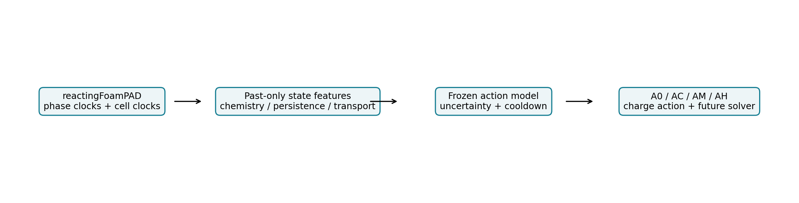
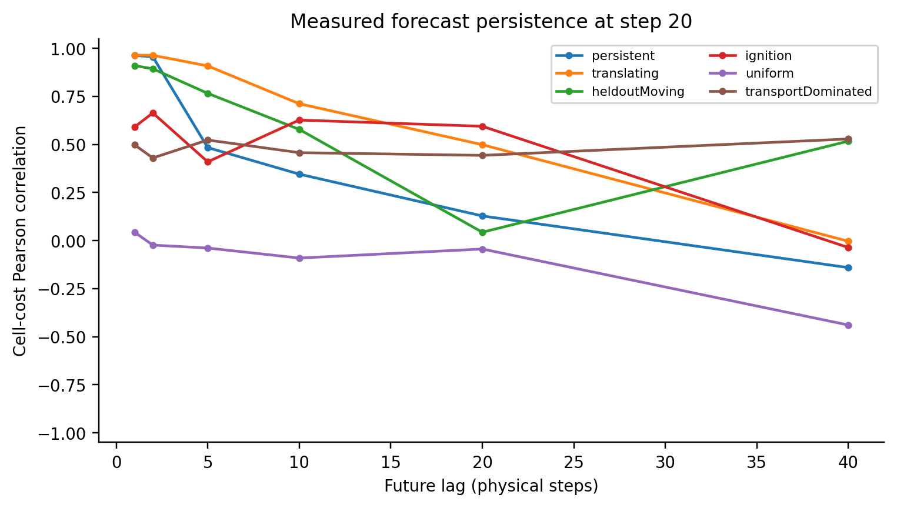
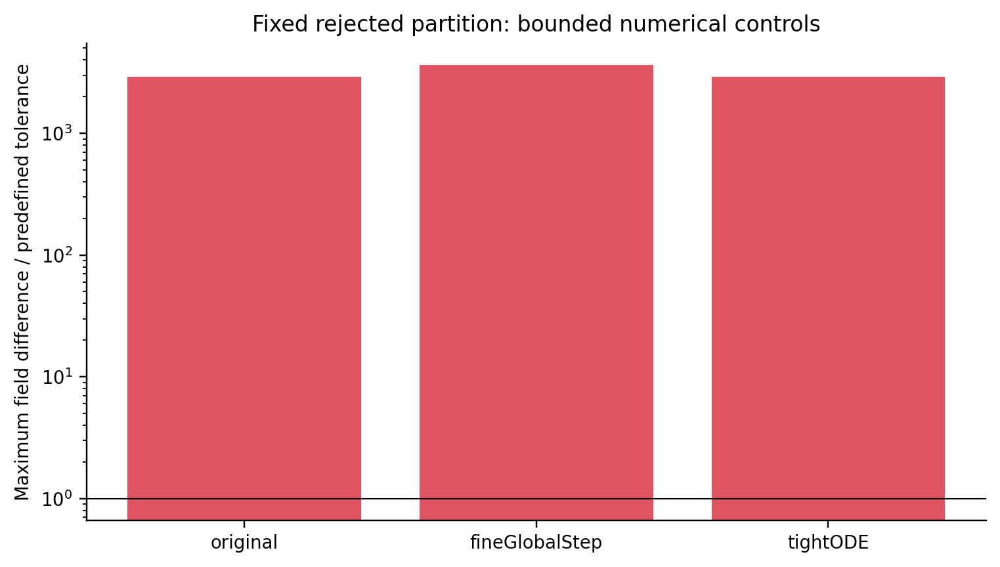
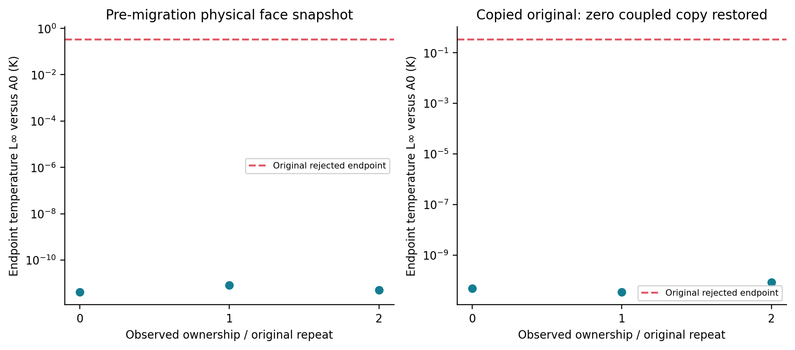
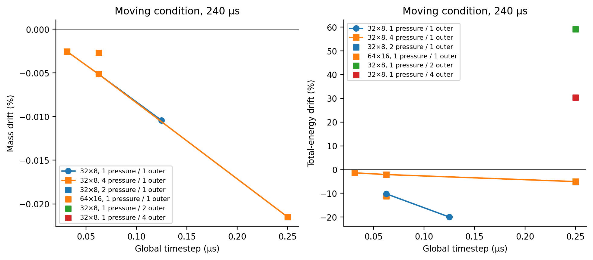
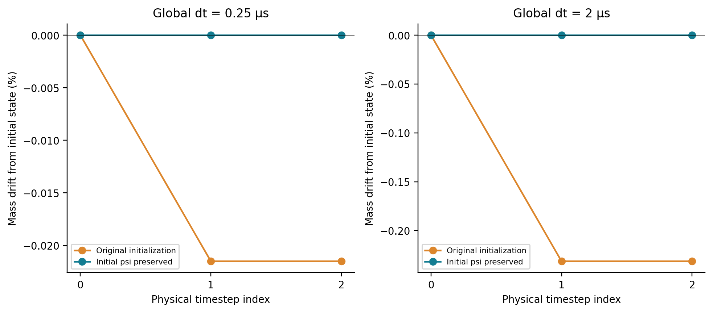
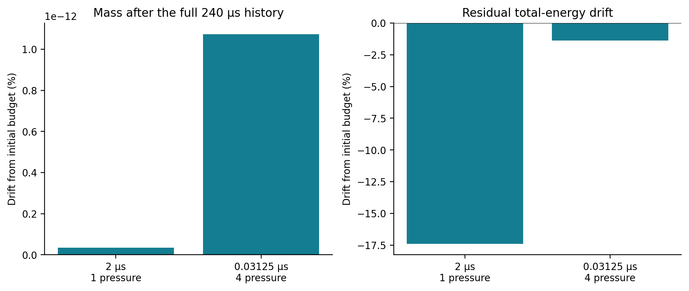
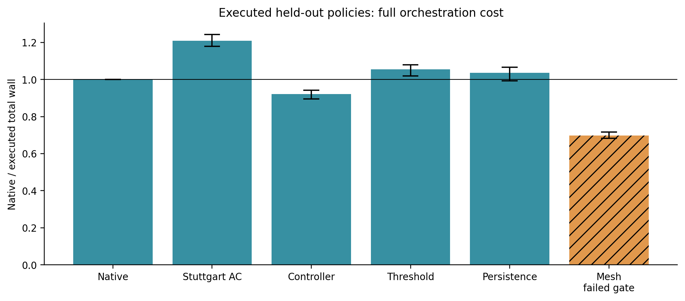
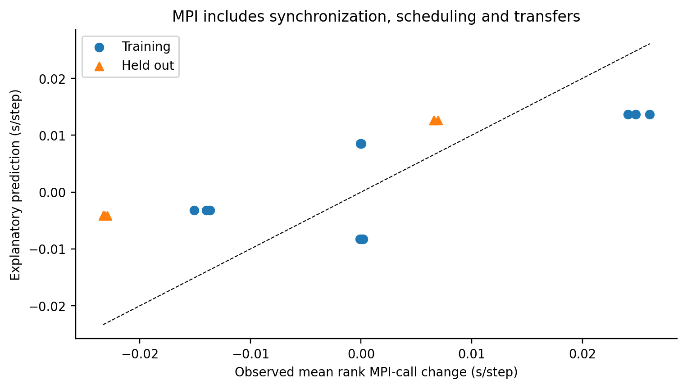
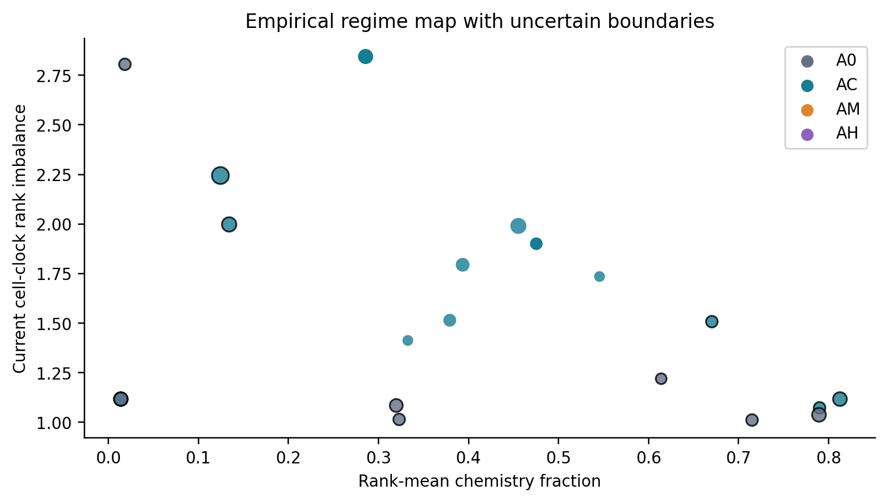

# Choosing load-balancing actions for reactive OpenFOAM: a measured oracle and a constrained controller

## Abstract

We compare unchanged ownership (A0), chemistry-task redistribution (AC), cost-weighted mesh redistribution (AM), and their hybrid (AH) using identical reacting-flow checkpoints, a compatible upstream chemistry baseline, and total future process cost. The corrected study contains 25 states and 500 randomized continuations, five trials per action. Median oracle winners are {'AC': 17, 'A0': 8}. The largest observed action speedup is 1.393×, pointwise 95% bootstrap interval [1.364, 1.437], at heldoutMoving, checkpoint 40 μs, H=80; this is an exploratory maximum, not a universal or confirmatory claim. The held-out retrospective whole-cost selector achieves 1.027× versus 1.190× for the executed chemistry algorithm's always-enabled action. Actual held-out live controller speedup relative to uninterrupted native standard chemistry is 0.922× [0.895, 0.942]. Algorithmic field equivalence and physical accuracy are assessed separately. Coarse transient budgets and refinement results restrict physical interpretation. The contribution is a reproducible local action-oracle and negative/conditional tradeoff evidence; it does not establish a new partitioner, a new adaptive-balancing principle, or a generally superior controller.

## Introduction and motivation

Detailed chemistry has heterogeneous cell integration cost, while mesh ownership also determines transport, pressure, halos and locality. A more balanced chemistry phase can therefore yield a slower full simulation. Task offloading changes where independent ODEs execute while retaining finite-volume ownership; mesh redistribution changes every mesh-associated phase. Measuring these alternatives together is necessary before investing in a sophisticated selector.

## Research questions

The study asks which action minimizes J(a,H)=Cdecision+Cmigration+future solver wall, when an apparent gain survives setup costs and numerical gates, whether past-only workload features predict that action on unseen operating conditions, and whether actual controller overhead leaves usable oracle headroom. It also asks what the available single-node hardware can and cannot establish about scaling and novelty. The fifteen requested questions are answered explicitly in [answers.md](answers.md).

## Related work

The literature ledger contains 40 entries across chemistry scheduling, graph repartitioning, runtime systems, GPU chemistry and solver selection. [Gärtner et al.](https://doi.org/10.1016/j.cpc.2024.109322) supplies the directly executed standard chemistry baseline; its paper's chemistry-phase speedups exclude PDE/auxiliary cost. [DLBFoam](https://doi.org/10.1016/j.cpc.2021.108073) separates task balancing from reference-cell filtering. [Cuoci's workshop material](https://zenodo.org/records/18670150) already describes adaptive migration-aware chemistry scheduling. [van den Oord et al.](https://doi.org/10.1177/10943420251329199) discusses persistence and independent chemistry/EoS redistribution. [DRAMA](https://chriswalshaw.co.uk/papers/fulltext/BasermannApMM00.pdf) already models costs across application phases. Proactive prediction, separate ODE maps, and weighted native mesh balancing also have established implementations. See [claim_verification.md](claim_verification.md), [related_work_comparison.md](related_work_comparison.md), and [novelty_search.md](novelty_search.md) for primary evidence, scope and unresolved access failures.

## OpenFOAM architecture

reactingFoamPAD retains the v2012 finite-volume equations and adds rank-local phase clocks. costOde follows the standard ODE cell loop and records cell integration clocks and substeps. Additional h-to-T corrections are opt-in and set to two for every action in these detailed-chemistry cases; this is a common numerical setting, not an unnoticed baseline change. The controller is an external Python process orchestrator. AC executes inside the chemistry library. AM runs native redistributePar between solver processes, so its wall includes process startup, field I/O and redistribution. It is not an in-solver adaptive mesh implementation.



## Baseline implementations

Stuttgart source is pinned to c67d87052ec29375c5d3580888aa65a64917024b. The private standard-only v2012 port retains rank pairing, previous-cell-cost ordering, the 2% cell-transfer threshold, microsecond upstream clocks, nonblocking exchanges, and every-step update. It registers psiReactionThermo/gasHThermoPhysics with EulerImplicit and ode; TDAC is excluded. API adaptations, passive chemCost/chemDeltaT fields and license are retained in [stuttgart_v2012.patch](stuttgart_v2012.patch). Native standard ode, costOde and the compatible task algorithm pass their initial field regression. This comparison uses the same OpenFOAM, integrator, tolerances, mesh and compiler rather than conflating versions or Jacobian/filtering acceleration.

The public QUICKLB 0.02 library is additionally compiled with GNU Fortran in an isolated MPI/Python environment and run on a small Gray–Scott kernel. This is third-party library reproduction, not reproduction of the INCA Spray-A paper or a direct CFD speedup comparison. The full public INCA dataset is about 20.1 GB and the matching INCA executable is unavailable.

## Existing and synthetic experiments

The earlier project remains in the parent directory with its original synthetic workload study, weighted Scotch implementation, thirty figures and report. Its persistent LTS result was reconstructed from raw five-trial manifests: 2.01698/1.74009=1.15912× solver-only, excluding training/decomposition. The exploratory interval is [1.03009,1.22309]. The short global-step experiment did not establish a gain. These are reference evidence, not the headline for the new transient study. Synthetic imbalances isolate scheduling behavior but do not substitute for reactive physics or validate flame propagation.

## Reactive-flow test cases

The main oracle uses a closed periodic 20×8×1 mm domain, 32×8×1 cells, laminar flow, globally fixed Euler dt=2 μs, first-order upwind convection, strict linear tolerance 1e-14 and zero relTol. Chemistry uses Rosenbrock34, absTol=1e-12, relTol=1e-5, initial chemical step 1e-7 s and Treact=500 K. H2 chemistry has ten species and 27 reactions. GRI has 53 species and 325 reactions but is also driven by H2 premix; carbon chemistry is inactive. It is a mechanism-size experiment, not an unseen-mechanism generalization test.

Persistent, translating, ignition, decay, uniform, chemistryDominated and transportDominated are hypotheses describing initial conditions. Three additional held-out conditions change velocity, temperature or width. Measured temperature, heat-release and cell-clock histories determine which intended behavior actually develops. These coarse kernels solve reactive-flow equations but are not resolved flames or validated burner models. TransportDominated is a cold inactive-chemistry control; its importance is limited headroom and overhead, not an established expensive turbulent transport regime.

## Workload characterization and persistence

We measure chemistry fraction, current and previous rank imbalance, cell-cost CV, circular center of cost and observed displacement, expensive-region Jaccard overlap, and past-cost correlation. The bounded lifetime estimate −lag/log(ρ), capped at 1000 steps, is an empirical feature rather than a fitted physical lifetime law. EMA means a two-snapshot 0.5 blend. Future trace values are used only in diagnostic correlation-versus-lag figures; they are excluded from model inputs and from live controller memory.



## Oracle action experiment

Each candidate copies the same mesh/field checkpoint and chemistry timestep history; duplication for an experiment is excluded, while weight acquisition/construction, configuration, native migration and solver process wall are charged. The mesh weight reader currently performs the whole extraction pass, including additional diagnostic features; this is actual measured implementation overhead, not a minimal in-solver weight-reader estimate. Early manifests' independently measured acquisition clocks are charged exactly once by the collector. No estimated duration or trial removal is used.

An inherited global timeIndex formerly caused periodic writes before the actual end; affected runs remain under interiorWriteProtocol and are excluded. A second epoch used native restart initialization and passed same-action gates, but did not preserve static dpdt and the previous psi coefficient: segmented/native comparisons differed by up to 68.4 K. That epoch remains under nativeRestartProtocolV2 and is also excluded from final claims. The final protocol forces physical endpoints, stores solved h/rho/dpdt and initializes psi.oldTime before its first thermodynamic update at a restart. Continuous and segmented standard chemistry now match to approximately 1e-9 K in the restart regression. The full oracle and dependent experiments are regenerated under that protocol. Every rank's exact step count, unique times and endpoint are asserted; a seven-step continuation from inherited index twenty directly exercises output semantics.

| Condition | Checkpoint (μs) | H | Winner | AC speedup [95% CI] | AM speedup | AH speedup |
|---|---|---|---|---|---|---|
| chemistryDominated | 40 | 20 | AC | 1.205 [1.183, 1.217] | 0.779 | 1.156 |
| decay | 200 | 80 | AC | 1.039 [0.917, 1.135] | 0.513 | 0.532 |
| decay | 40 | 80 | AC | 1.056 [0.970, 1.098] | 0.515 | 0.522 |
| heldoutIgnition | 200 | 80 | AC | 1.210 [1.177, 1.241] | 0.848 | 1.060 |
| heldoutIgnition | 40 | 80 | A0 | 0.967 [0.901, 1.163] | 0.534 | 0.562 |
| heldoutMoving | 200 | 80 | AC | 1.001 [0.984, 1.034] | 0.822 | 0.835 |
| heldoutMoving | 40 | 80 | AC | 1.393 [1.364, 1.437] | 0.861 | 1.234 |
| heldoutPersistent | 200 | 80 | A0 | 0.957 [0.897, 1.041] | 0.720 | 0.720 |
| heldoutPersistent | 40 | 80 | AC | 1.145 [1.101, 1.185] | 0.650 | 1.056 |
| ignition | 200 | 80 | AC | 1.041 [0.940, 1.075] | 0.769 | 0.744 |
| ignition | 40 | 80 | AC | 1.197 [1.147, 1.280] | 0.738 | 1.021 |
| persistent | 200 | 80 | AC | 1.011 [0.990, 1.091] | 0.747 | 0.819 |
| persistent | 40 | 20 | AC | 1.351 [1.258, 1.439] | 0.790 | 0.928 |
| persistent | 40 | 80 | AC | 1.214 [1.181, 1.262] | 0.715 | 1.071 |
| persistent | 40 | 320 | AC | 1.168 [1.140, 1.182] | 0.724 | 1.089 |
| translating | 200 | 80 | A0 | 0.996 [0.960, 1.252] | 0.548 | 0.547 |
| translating | 40 | 20 | AC | 1.261 [1.197, 1.292] | 0.563 | 0.599 |
| translating | 40 | 80 | AC | 1.318 [1.259, 1.407] | 0.684 | 0.820 |
| translating | 40 | 320 | AC | 1.146 [1.121, 1.201] | 0.752 | 0.801 |
| transportDominated | 200 | 80 | A0 | 0.998 [0.967, 1.026] | 0.468 | 0.456 |
| transportDominated | 40 | 20 | A0 | 0.997 [0.969, 1.150] | 0.390 | 0.370 |
| transportDominated | 40 | 80 | AC | 1.002 [0.979, 1.150] | 0.477 | 0.476 |
| transportDominated | 40 | 320 | A0 | 0.991 [0.951, 1.041] | 0.663 | 0.651 |
| uniform | 200 | 80 | A0 | 0.979 [0.822, 1.016] | 0.547 | 0.549 |
| uniform | 40 | 80 | A0 | 0.989 [0.964, 1.036] | 0.883 | 0.860 |

The oracle label is the minimum of repeated action medians subject to field validity. Small best–second margins can be noise. The complete four-action sweep and all trials are retained; no outliers are removed. The held-out hindsight oracle offers only 0.43% additional aggregate speedup over always enabling AC in this dataset. This is optimistic headroom, because it chooses among noisy observed medians.

An independent preselected replication uses twenty trials per action for the moving positive condition and uniform negative condition, without refitting the model. Moving AC/A0 speedup is 1.361× [1.345, 1.396], medians 7.5812/5.5694 s. Uniform AC/A0 is 0.981× [0.964, 1.002]. Both use four ranks, 256 cells, checkpoint 40 μs and H=80 global 2 μs steps, including action and whole continuation process cost. These confirm the chosen conditions, not the exploratory maximum or all possible flows.

## Predictive model and performance objective

The interpretable ridge model predicts each action's solver delta using chemistry work over H, imbalance-derived excess, persistence-adjusted excess, transport/pressure duration, and processor faces per cell. It adds training-set median action costs, a conservative 90th-percentile absolute residual margin from training plus whole validation cases, and a minimum gain margin max(0.02 s, 2.5% of estimated future timestep work). The residual margin is not a probabilistically calibrated confidence interval. A0 has zero incremental score. Ownership/scheduler changes have a forty-step cooldown.

A separate explanatory transport model uses observed post-partition face ratio, cell-count CV, chemistry fraction and mechanism size to predict rank-mean cumulative transport/pressure change. Held-out MAE is 0.01002 s per step. This quantity includes waits and is not pure network cost. Post-partition features require candidate partition work; the model is not deployed as a free online prediction. The initial face feature in the main controller is constant in same-grid states, so communication consequences are not independently identified by that coefficient.

An additional explanatory MPI-call-duration model uses the two profiled training conditions and twenty-four new on/off trials in heldoutMoving. Six held-out AM/AH profiled runs give MAE 0.01246 s per step. This model uses observed partition geometry, neighbor count, chemistry fraction and the hybrid-task indicator. It predicts time inside MPI, including synchronization and scheduling, rather than an isolated network-transfer penalty. Two training conditions and one test condition do not establish broad predictive generalization.

## Runtime controller and cost accounting

Independent checkpoint deployment runs A0, AC, AM and the frozen controller, five repeats at two checkpoints in each held-out condition. Feature extraction is charged to prediction/threshold policies and to mesh weights; inference is charged where used. Live runs use a genuinely measured twenty-step prefix followed by three forty-step segments. The state-preserving executable restores solved h and dpdt and preallocates psi.oldTime before its first restart update. All live policies reach 280 μs and include preprocessing, decomposition, prefix, every startup, write, decision and migration. Nine executed arms include uninterrupted native, instrumented standard and Stuttgart chemistry; segmented A0/AC/AM; and the three adaptive policies. Build costs are offline. Model acquisition is separate from per-case use, rather than hidden as free training.

Native v2012 repeated redistribution exposed a physical-patch synchronization check that failed to exclude processorCyclic patches. A private redistributeParPAD utility changes that check and its executable target only; the installed utility and partition/redistribution algorithm are preserved. Live mesh arms use the private utility and pay its measured process cost. First-migration fields match the native utility, three successive migrations preserve their instantaneous state, and the final trajectory matches uninterrupted native chemistry. The source patch and failed AM live runs are retained. Single-migration oracle, profile and scaling experiments use the installed utility.

Every completed live segment retains its rank clocks and solver log before the next process starts; migration checkpoints retain ownership maps. One completion attempt overlapped the one-time evidence archive and lost its case path during endpoint validation. That stopped attempt is preserved under liveRetentionRace. The complete randomized live collection was rerun with finalized retention code, with the same jobs, seed, repetitions, frozen model and numerical settings. Partial/rejected attempts never supply final performance summaries.

The measured train/validation oracle acquisition alone costs at least 1457.0 s; it also excludes common source-history generation, experiment duplication and analysis. Ridge fitting takes 1.536 ms. A reusable offline model may amortize those costs over many runs, but this small held-out set does not establish such reuse in production.

## Numerical verification

The main oracle has 375 candidate-versus-A0 endpoint gates, of which 0 fail. Maximum temperature difference is 1.69403e-07 K. Fields include T, p, U, Qdot, h, rho and every species; positivity and |ΣY−1|<1e-10 are also required. L1, L2 and L∞ norms, logged linear residuals/iteration counts, integrated observables, and native mass/species/element/energy budgets are retained. The gate uses absolute plus field-scale relative tolerances rather than division by trace-species values. Rejected schemes and pilot failures are not erased.

All 12 additional restarted-A0 versus uninterrupted trajectory gates pass, including all ten operating conditions and two independent longer native trajectories. This verifies the physical checkpoint state used by the oracle independently of comparisons between candidate actions. Live, deployment, profile, scaling and fine-timestep action gates are retained separately.

The live collection has 120 endpoint comparisons and 1 failed gate. The rejected live trial(s) are data/raw/live/heldoutMoving_AM_r0. They remain in their timing distributions; affected policy aggregates are numerically ineligible and cannot support speedup claims. Historical ownership-map diagnostics and fixed-partition replay, finer-global-step and tighter-ODE controls are retained in live_mesh_diagnosis.json and live_mesh_followup.json. The predefined tolerances and original trials are unchanged. The deployed controller and chemistry baseline retain passing gates.



The surface audit finds eight exactly zero processorCyclic flux copies in the rejected third migration, while the paired periodic copies are nonzero. No sign reversal is observed. A separate axis-aligned, stationary-mesh utility snapshots physical face identity outside the native mapper. All three fixed observed ownership maps pass preservation and endpoint gates; ordinary manual mapping also passes, so ownership alone does not reproduce the original failure. Independently, filling the exact-zero coupled copies from their existing nonzero partners in copies of the original post-migration states reduces the worst endpoint temperature difference to 8.23093e-11 K; all three corrected controls pass. These controls isolate the surface-state loss without using reference fields to repair it. Preparation and restoration each launch MPI and are charged in their manifests (median combined preservation cost 0.588 s). The helper uses O(global faces) storage per rank and supports axis-aligned stationary geometry with translational x-periodicity only. It is a correctness reference, not a scalable generic mapper. The first rejected unoriented-field approach is preserved locally; the delivered implementation bypasses that mapper. Original live timings, their failed gate, and mesh-policy ineligibility remain unchanged.



A separate final-epoch audit checks 1121 endpoints for finite values in every primary field and species, positive T/p/rho, species positivity and normalization. This guards against NaNs being hidden by comparisons and provides basic thermodynamic admissibility; it does not replace conservation or convergence tests.

Algorithmic equivalence is distinct from physical accuracy. Maximum closed-history mass drift is 0.2315% and maximum relative total-energy drift is 22.553%. The energy reference can be small relative to reaction chemical energy; both absolute inventory terms and reference normalization are retained. Refinement changes temperatures by tens of kelvin and heat release also changes with grid size. The dt=0.25 μs action study repeats the same 160 μs future interval with 640 global steps. This is an accuracy sensitivity check, not a claim of spatially resolved or converged flame physics.

| Condition | Action | Median total wall (s) | A0/action | 95% CI | Field gate |
|---|---|---|---|---|---|
| persistent | A0 | 12.272 | 1.000 | [1.000, 1.000] | True |
| persistent | AC | 10.161 | 1.208 | [1.160, 1.240] | True |
| persistent | AM | 12.132 | 1.012 | [0.974, 1.038] | True |
| persistent | AH | 10.833 | 1.133 | [1.093, 1.185] | True |
| heldoutMoving | A0 | 20.668 | 1.000 | [1.000, 1.000] | True |
| heldoutMoving | AC | 17.353 | 1.191 | [1.156, 1.204] | True |
| heldoutMoving | AM | 21.570 | 0.958 | [0.939, 0.970] | True |
| heldoutMoving | AH | 18.001 | 1.148 | [1.122, 1.172] | True |

Nine additional bounded accuracy pilots investigate the moving condition's energy-budget failure over the same 240 μs history. Seven independent controls decrease dt to 0.125 and 0.0625 μs, increase pressure correctors, refine the grid at the finest dt, and separately increase PIMPLE outer correctors to test coupling of species, energy and pressure. Two further controls combine four pressure corrections with 0.0625 and 0.03125 μs timesteps, following the observed independent effects. These diagnostics do not refit the frozen controller or replace the performance dataset. Absolute energy values accompany the normalized drift, preventing a small reference denominator from being mistaken for a field error estimate.

| Grid | dt (μs) | Pressure correctors | Outer correctors | Mass drift (%) | Initial E (J) | Final E (J) | ΔE (J) | ΔE / |E₀| (%) | Maximum T (K) |
|---|---|---|---|---|---|---|---|---|---|
| 32×8 | 0.125 | 1 | 1 | -0.01044 | 0.0174966 | 0.0140017 | -0.00349488 | -19.9746 | 2928.39 |
| 32×8 | 0.0625 | 1 | 1 | -0.00514 | 0.0174966 | 0.015711 | -0.00178565 | -10.2057 | 2958.68 |
| 32×8 | 0.25 | 2 | 1 | -0.02150 | 0.0174966 | 0.0165813 | -0.000915286 | -5.2312 | 2918.19 |
| 32×8 | 0.25 | 4 | 1 | -0.02150 | 0.0174966 | 0.0166144 | -0.000882175 | -5.0420 | 2918.64 |
| 64×16 | 0.0625 | 1 | 1 | -0.00270 | 0.0174966 | 0.0155257 | -0.00197082 | -11.2640 | 2976.14 |
| 32×8 | 0.25 | 1 | 2 | -0.02150 | 0.0174966 | 0.0278407 | 0.0103441 | 59.1206 | 2935.72 |
| 32×8 | 0.25 | 1 | 4 | -0.02150 | 0.0174966 | 0.0228112 | 0.00531459 | 30.3750 | 2943.57 |
| 32×8 | 0.0625 | 4 | 1 | -0.00514 | 0.0174966 | 0.0171319 | -0.00036476 | -2.0847 | 2925.00 |
| 32×8 | 0.03125 | 4 | 1 | -0.00255 | 0.0174966 | 0.0172565 | -0.000240081 | -1.3722 | 2927.73 |



The signed energy drift is a discretization/thermodynamic-coupling diagnostic; it is not an action-versus-reference norm. Passing action gates therefore supports an algorithmic comparison on this discretized problem, while these budgets set the limit on its physical validity.

The moving condition's energy drift is not monotonic under the initial timestep refinement (about −21% at 0.5 μs and −28% at 0.25 μs). Four pressure correctors at 0.25 μs reduce the magnitude to about 5%; combining them with 0.0625 and 0.03125 μs gives about −2.08% and −1.37%. More outer correctors instead give positive drifts of about 59% and 30% in the separate 0.25 μs pilots. These results motivate a coupled convergence study, and do not establish a resolved flame or energy convergence.

A separate two-step diagnostic identifies an initial-coefficient mass offset: original initialization reaches 0.231461% drift, while preallocating initial psi.oldTime before the first thermo update gives at most 2.2377e-14%. The diagnostic executable changes this initialization condition only and is excluded from the frozen performance dataset. Long-time energy and spatial convergence remain separate.



The same initialization-only executable is tested over the full 240 μs moving history. dt=2 μs with 1 pressure corrector(s): mass drift 3.35655e-14%, signed energy drift -17.3887%; dt=0.03125 μs with 4 pressure corrector(s): mass drift 1.0741e-12%, signed energy drift -1.3692%. The mass correction persists; residual energy error is a separate coupled-discretization limitation. No original timing or field-gate eligibility is replaced.



## Experimental and statistical methodology

One AMD Ryzen 5 5600X host supplies six physical cores and twelve hardware threads under WSL2. OpenCFD v2012 uses GCC 6.3, -O3, double precision, 32-bit labels, OpenMPI 4.0.3 and Scotch 6.0.9. MPI processes are bound to physical cores with no oversubscription; OMP is one. Existing pilots/source histories and the explicit MPI regression supply warmup. Timed campaigns execute sequentially. Randomized trial order is seeded and retained. Whole process wall uses blocking wait with an independent timeout watchdog, avoiding quantized polling clocks. Rank phase clocks add no collectives. Hardware frequency/thermal variation is not controlled by a hardware counter and remains a threat.

Tables retain n, median, arithmetic mean, sample standard deviation, min, max and CV. Independent median ratios use 4000 bootstrap resamples with fixed seeds. Five trials are modest; three live trials yield particularly coarse uncertainty. Intervals are pointwise and exploratory, not simultaneous, population-level or corrected for selecting a best state. Aggregate held-out ratios sum condition medians; their within-condition intervals resample runs while retaining the same three test conditions.

Replay aggregate intervals additionally resample measured trial costs within the six fixed test checkpoint states, retaining the fitted policy choices, observed oracle labels and decision-overhead estimates. An A0 choice shares its baseline draw. These conditional intervals exclude model-fitting and physical-case population uncertainty; an interval around the hindsight oracle does not remove its selection optimism.

## Scaling results

The 512-cell scaling campaign compares A0, AC and the frozen controller at 1, 2, 4 and 6 bound physical cores, five trials each. Each rank count has a measured prefix; all policies at that rank count start from identical fields. Additional cross-rank native trajectory gates compare the complete prefix and continuation against the one-rank physical endpoint. The four-rank/256-cell model is extrapolated to new rank counts and cell counts; rank one has a no-action guard. Strong scaling includes continuation and action overhead, while the common prefix is separately recorded. There is one host, no Slurm installation/allocation and no inter-node network. Startup and small-domain costs can dominate, so this is not evidence of large-scale HPC scalability.

| Ranks | Policy | Median action + solver wall (s) | Strong-scaling speedup | Efficiency |
|---|---|---|---|---|
| 1 | A0 | 10.824 | 1.000 | 1.000 |
| 1 | AC | 10.872 | 1.000 | 1.000 |
| 1 | controller | 10.845 | 1.000 | 1.000 |
| 2 | A0 | 8.052 | 1.344 | 0.672 |
| 2 | AC | 6.246 | 1.741 | 0.870 |
| 2 | controller | 6.243 | 1.737 | 0.869 |
| 4 | A0 | 5.358 | 2.020 | 0.505 |
| 4 | AC | 3.966 | 2.741 | 0.685 |
| 4 | controller | 4.036 | 2.687 | 0.672 |
| 6 | A0 | 4.318 | 2.507 | 0.418 |
| 6 | AC | 3.457 | 3.145 | 0.524 |
| 6 | controller | 4.350 | 2.493 | 0.416 |

## Controller results and decision regret

The requested eight policies are compared retrospectively; AC already contains the upstream adaptive rank-pair task behavior. Actual live runs additionally execute the threshold and persistence policies. The hindsight oracle cannot be executed online without counterfactual future trials. Regret is selected total cost minus minimum observed action median. Feature-driven AM/AH reuse the acquisition pass already charged in the action cost, adding only the policy's own inference clock. A0/AC selections instead add their required feature acquisition. Replay accounting is refreshed without refitting the frozen model, and its fingerprint is asserted. HarmfulFraction uses a positive median cost difference, not a statistical claim of harm. Unnecessary and missed decisions are explicitly counted.

| Held-out replay policy | Aggregate speedup [conditional 95% CI] | Mean regret (s) | Worst regret (s) | Oracle-optimal fraction |
|---|---|---|---|---|
| never | 1.000 [1.000, 1.000] | 0.644 | 2.175 | 0.333 |
| imbalanceThreshold | 1.184 [1.168, 1.200] | 0.031 | 0.032 | 0.833 |
| periodicChemistry | 1.190 [1.173, 1.211] | 0.014 | 0.064 | 0.667 |
| periodicMesh | 0.767 [0.755, 0.779] | 1.845 | 4.198 | 0.000 |
| stuttgartEveryStep | 1.190 [1.174, 1.209] | 0.014 | 0.064 | 0.667 |
| persistenceBreakEven | 1.133 [1.122, 1.149] | 0.179 | 0.917 | 0.667 |
| wholeSolver | 1.027 [1.017, 1.036] | 0.541 | 2.205 | 0.500 |
| oracle | 1.195 [1.179, 1.212] | 0.000 | 0.000 | 1.000 |

The live results below use uninterrupted native standard chemistry as the reference, so they expose the actual external-orchestration price. A segmented-A0 reference is also retained to distinguish model action utility from the cost of segmenting a simulation. A ratio with false numerical eligibility is descriptive cost evidence, not a valid performance gain. The failed trial is retained rather than removed from its distribution.

| Executed policy | Held-out end-to-end runtime ratio | 95% within-condition bootstrap interval | Numerically eligible |
|---|---|---|---|
| nativeContinuous | 1.000 | [1.000, 1.000] | True |
| continuous | 0.996 | [0.962, 1.015] | True |
| ACContinuous | 1.209 | [1.178, 1.243] | True |
| A0 | 0.887 | [0.861, 0.924] | True |
| AC | 1.044 | [1.004, 1.067] | True |
| AM | 0.697 | [0.682, 0.717] | False |
| imbalanceThreshold | 1.054 | [1.019, 1.079] | True |
| persistenceBreakEven | 1.037 | [0.992, 1.066] | True |
| controller | 0.922 | [0.895, 0.942] | True |



## Generalization

Training uses entire persistent, translating, ignition, cold-control and GRI-size conditions. Validation uses whole uniform and decay conditions. Test uses heldoutMoving, heldoutIgnition and heldoutPersistent. No random timestep split is used. Temperature/velocity/width changes within one periodic geometry are the tested generalization scope; they do not establish transfer to different burners, fuels, solvers, mechanisms or hardware. Live controller state comes only from its own completed prefix. Frozen model hashes accompany deployments, and test results are not used to refit coefficients or margins.

## Ablation studies

| Ablation | Held-out speedup | Mean regret (s) |
|---|---|---|
| full | 1.027 | 0.541 |
| noCommunication | 1.027 | 0.541 |
| noMigration | 1.027 | 0.541 |
| noPersistence | 0.992 | 0.674 |
| noTransport | 1.027 | 0.541 |
| noUncertainty | 1.130 | 0.189 |
| onlyEMA | 0.992 | 0.674 |
| onlyImbalance | 0.992 | 0.674 |
| onlyPreviousCost | 0.992 | 0.674 |

Removing uncertainty increases held-out replay speedup from 1.027× to 1.130×: the conservative margin misses useful AC opportunities here. It still falls below always-AC. Removing persistence reduces it to 0.992×. Omitting migration, communication or transport changes no measured chosen-action utility in this design; small timing differences in inference are not feature evidence. The communication input was constant, so its ablation cannot establish physical irrelevance. The transport omission replaces the fitted input by its training mean at inference. Previous-only and EMA variants are explicitly defined.

## Communication tradeoff and migration overhead

Rank-local phase maxima are not additive across overlapping MPI ranks. PMPI observes send payload bytes, receive buffer capacity, collective counts and MPI-call/wait durations without adding barriers. Those bytes are application buffers, not observed wire traffic; collectives are counted but their payload volume is not included. Wait time reflects synchronization and imbalance as well as transfer. Main timings use profiling off; a randomized three-repeat on/off calibration measures perturbation. Mesh redistribution PMPI is recorded separately. Face counts, neighbors, cell-count imbalance and linear iterations explain geometric/solver changes; cache misses and memory locality are not directly measured.



An approximate break-even H*=Caction/(observed mean solver savings per step) is reported only for positive savings and assumes those savings persist. A missing value means no positive measured use-phase saving. Measured H=20/80/320 sweeps are distinguished from any extrapolated crossing. The dimensionless lifetime/break-even ratio is a diagnostic and does not establish a universal threshold.

## Regime map

The map plots measured chemistry fraction and imbalance, sizes markers by past-cost lifetime and colors median oracle winners. A0 and intervals crossing unity are outlined to show weak separation. No clean decision boundary or unobserved winning region is imposed. Large imbalance matters only when the chemistry fraction and usable horizon leave enough savings after action and solver consequences.



## Discussion and negative results

The oracle is the first test of whether a more sophisticated selector is justified. A strong chemistry-only scheduler can consume most available headroom while retaining transport locality. A model can fit whole-cost deltas yet still select poorly after extraction, uncertainty and restart costs. Balanced current cell clocks need not predict future chemistry, and synchronous transport clocks can contain chemistry wait propagation. Weak action separation in uniform or late states is evidence against confident classification, not permission to report a small difference as a discovery.

The tested weighted-mesh and hybrid actions must be judged by their actual state medians and intervals in the complete table; no winning region is assumed. Native restart semantics and the stale-write failure show why field matching at a convenient output is insufficient. Physical budgets and refinement also prevent converting an algorithmic performance comparison into a validated combustion claim.

## Related-work comparison and novelty assessment

Weighted graphs, chemistry tasks, adaptive triggers, migration penalties, persistence, prediction and distinct physics decompositions are prior art. The search did not establish an identical earlier four-action same-version checkpoint dataset, but a bounded search cannot prove first invention. The narrow contribution is the local oracle/replay/deployment artifact, state-preserving live methodology, and measured limitations of this consequence model against an executed strong baseline. A controller superiority claim requires the actual held-out end-to-end table, not the existence of source code or a favorable chemistry timer.

## Limitations and threats to validity

One small WSL2 CPU host provides no inter-node evidence. OpenFOAM branch/version, GCC, MPI, Scotch and rank placement limit portability of numbers. Fixed mesh/geometry, H2 premix, carbon-inactive GRI, strict tolerances, upwind transport and opt-in thermo corrections define a narrow workload. Coarse reaction zones, temporal/spatial error and physical energy budgets limit physical inference. Thermal/frequency variation, filesystem cache, background host work and small sample counts limit statistics. Case selection covers negative controls but remains constructed. Whole-case splitting reduces leakage without creating broad physical diversity. Source clock noise changes labels, oracle selection is optimistic, and the model has more terms than independent training conditions. The communication feature is unidentifiable in its initial design. LTS and transient results are kept separate. PMPI cannot separate wire transfer, waits and collective topology.

## Reproducibility

From research/physicsAwareDecomposition run:

```bash
bash actionStudy/scripts/setup.sh
bash actionStudy/scripts/build.sh
bash actionStudy/scripts/buildRestart.sh
bash actionStudy/scripts/buildInventory.sh
bash actionStudy/scripts/buildMPI.sh
bash actionStudy/scripts/buildRedistributor.sh
bash actionStudy/scripts/buildFluxAudit.sh
bash actionStudy/scripts/buildFluxState.sh
bash actionStudy/scripts/reproduce.sh smoke
# Bounded pilot, in a fresh retained directory:
PAD_ACTION_ROOT=/tmp/pad-action-small bash actionStudy/scripts/reproduce.sh small
# Complete local study and artifact; output directory must be fresh:
export PAD_ACTION_ROOT=/tmp/pad-action-full
bash actionStudy/scripts/reproduce.sh full
python3 actionStudy/scripts/finish.py
```

The default is a smoke regression, not a cluster allocation. Compiler adaptation uses the documented user-space sysroot without changing the installed OpenFOAM. Raw transient fields/vendor/build products are ignored by Git and retained on this host; processed rows, compact timing evidence, source hashes, scripts, tables and figure source slices form the portable artifact. Every figure is regenerated from data. The fresh small-profile execution is recorded in reproduction_test.json. Rejected interiorWriteProtocol/nativeRestartProtocolV2 epochs and incomplete live attempts remain retained and excluded. License and citation metadata preserve upstream credit.

## Conclusions and future work

The available hardware establishes an audited local answer about action cost, predictive overhead and numerical equivalence, with explicit physical-accuracy limits. It does not establish universal thresholds, large-cluster scaling or a superior general controller. The useful next research boundary requires resolved/conserved physical cases, independently varying communication geometry, broader whole-case generalization and multi-node execution; unavailable network/HPC hardware cannot be replaced by oversubscribed local ranks. These are limitations of this artifact's external validity rather than unimplemented local benchmark steps.

## Publication assessment

The strongest present framing is an OpenFOAM technical/benchmark contribution or a workshop negative-result study. A conference/journal method paper would need demonstrated advantages over the strong task baseline on diverse resolved cases and meaningful multi-node scale. A software paper would need sustained public reuse and independent installation evidence. [JOSS's current submission requirements](https://joss.readthedocs.io/en/latest/submitting.html) require sustained public development and research impact, so a new burst of commits does not by itself make this artifact ready for that venue. No acceptance likelihood is asserted. A relevant technical audience is the [OpenFOAM Workshop](https://www.openfoamworkshop.org/).

## References and evidence

The complete [literature catalogue](literature.json), [BibTeX](references.bib), [primary-source ledger](claim_verification.md), [DOI registration metadata audit](bibliography_metadata_verification.json), [comparison table](related_work_comparison.md) and [novelty challenge](novelty_search.md) provide checked access levels. Local claims are generated from headline.json, oracle_summary.json, live_aggregate.json and the full CSV tables; qualityControl.py checks their raw provenance and gates. The research log records meaningful engineering failures and scientific decisions.
