# Scientific figure index

## 01. 01_T_initial

Reactive kernel at 40 μs. Same 32×8 grid and camera; ownership is assembled using migrated canonical cell IDs. Cell clocks are measured wall times, not reaction rates.

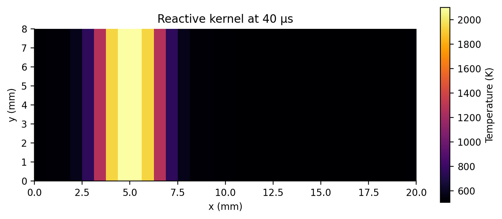

Data: [01_T_initial.source.json](01_T_initial.source.json)

## 02. 02_chemCost_initial

Measured chemistry cost at 40 μs. Same 32×8 grid and camera; ownership is assembled using migrated canonical cell IDs. Cell clocks are measured wall times, not reaction rates.

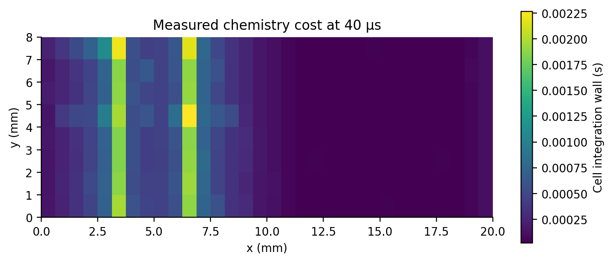

Data: [02_chemCost_initial.source.json](02_chemCost_initial.source.json)

## 03. 03_owner_initial

Initial Scotch ownership. Same 32×8 grid and camera; ownership is assembled using migrated canonical cell IDs. Cell clocks are measured wall times, not reaction rates.

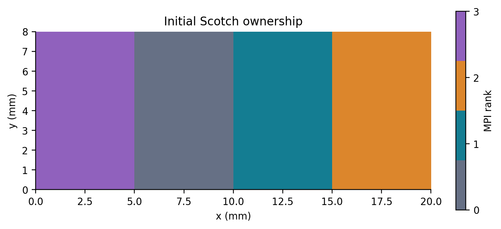

Data: [03_owner_initial.source.json](03_owner_initial.source.json)

## 04. 04_owner_weighted

Cost-weighted Scotch ownership. Same 32×8 grid and camera; ownership is assembled using migrated canonical cell IDs. Cell clocks are measured wall times, not reaction rates.

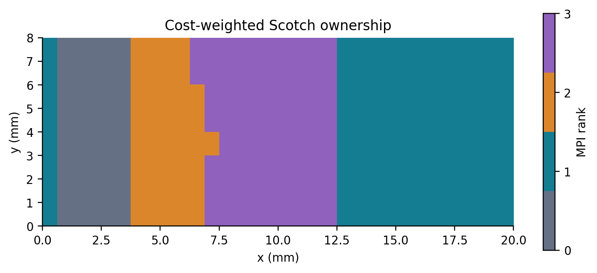

Data: [04_owner_weighted.source.json](04_owner_weighted.source.json)

## 05. 05_processor_interfaces

Cyan lines mark internal ownership changes. Cyclic boundary interfaces also count in quantitative face totals but lie at box boundaries.

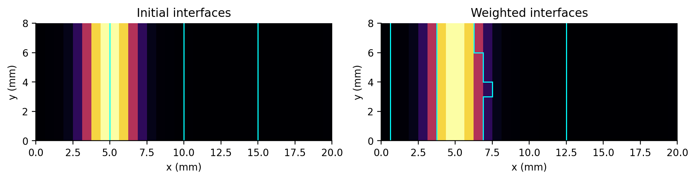

Data: [05_processor_interfaces.source.json](05_processor_interfaces.source.json)

## 06. 06_moving_sequence

Moving-condition temperature sequence with an identical camera and shared data-range color scale. These coarse controlled kernels are not validated flame fronts.

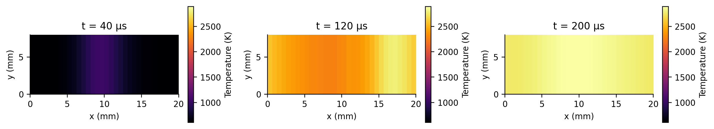

Data: [06_moving_sequence.source.json](06_moving_sequence.source.json)

## 07. 07_workload_by_rank

Checkpoint cell-clock sums assigned to old and new owners. This diagnostic does not assume that future cell costs stay fixed.

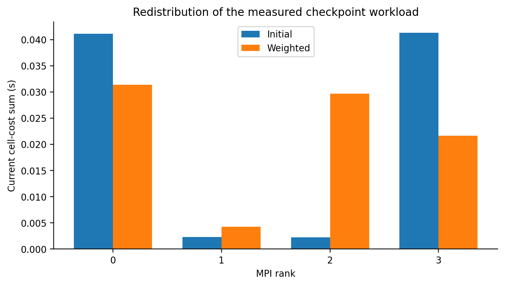

Data: [07_workload_by_rank.source.json](07_workload_by_rank.source.json)

## 08. 08_chemistry_by_rank

Rank-local integrated phase durations from repeat zero, persistent checkpoint 40 μs. Phases overlap across ranks and their maxima must not be added to infer a critical path.

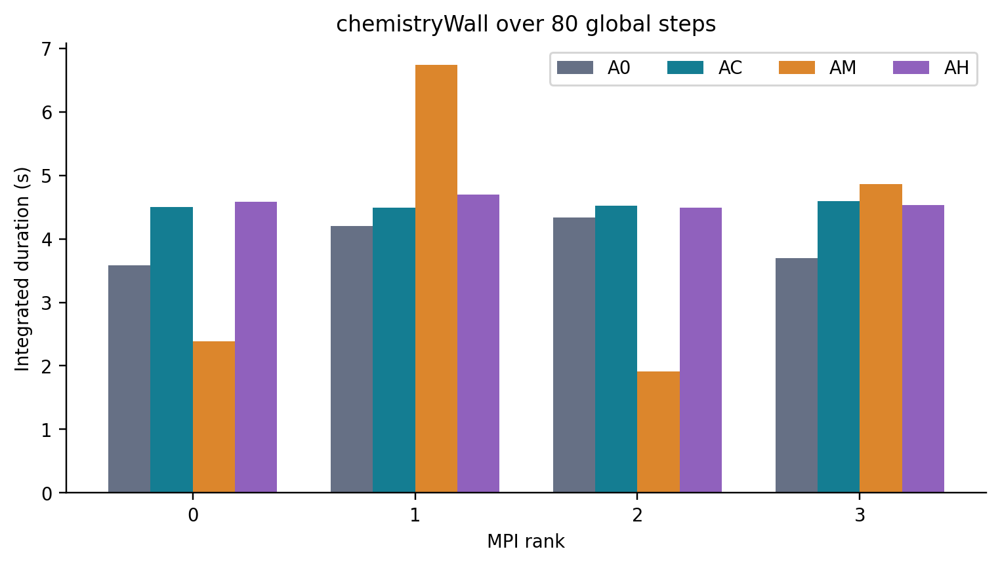

Data: [08_chemistry_by_rank.source.json](08_chemistry_by_rank.source.json)

## 09. 09_timestep_by_rank

Rank-local integrated phase durations from repeat zero, persistent checkpoint 40 μs. Phases overlap across ranks and their maxima must not be added to infer a critical path.

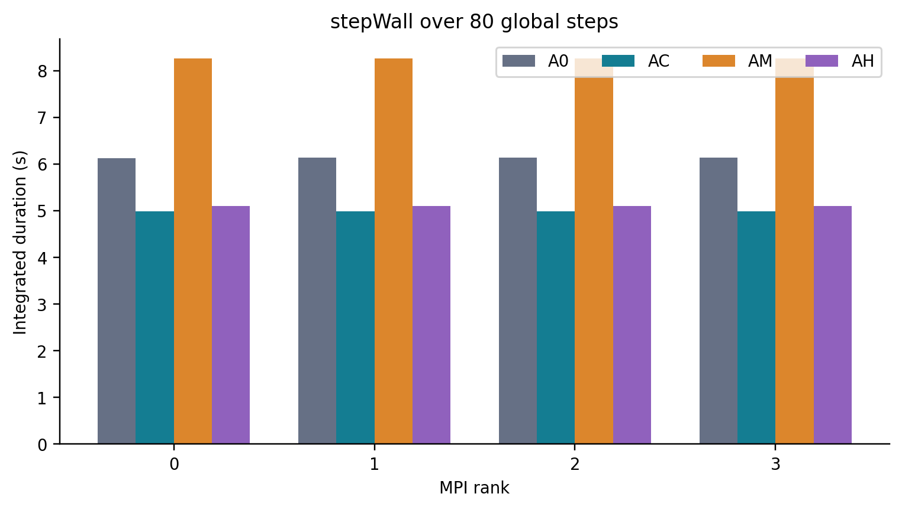

Data: [09_timestep_by_rank.source.json](09_timestep_by_rank.source.json)

## 10. 10_all_action_costs

Complete oracle state set, five randomized trials per action. Total cost includes action configuration, native mesh redistribution and solver process startup plus endpoint I/O.

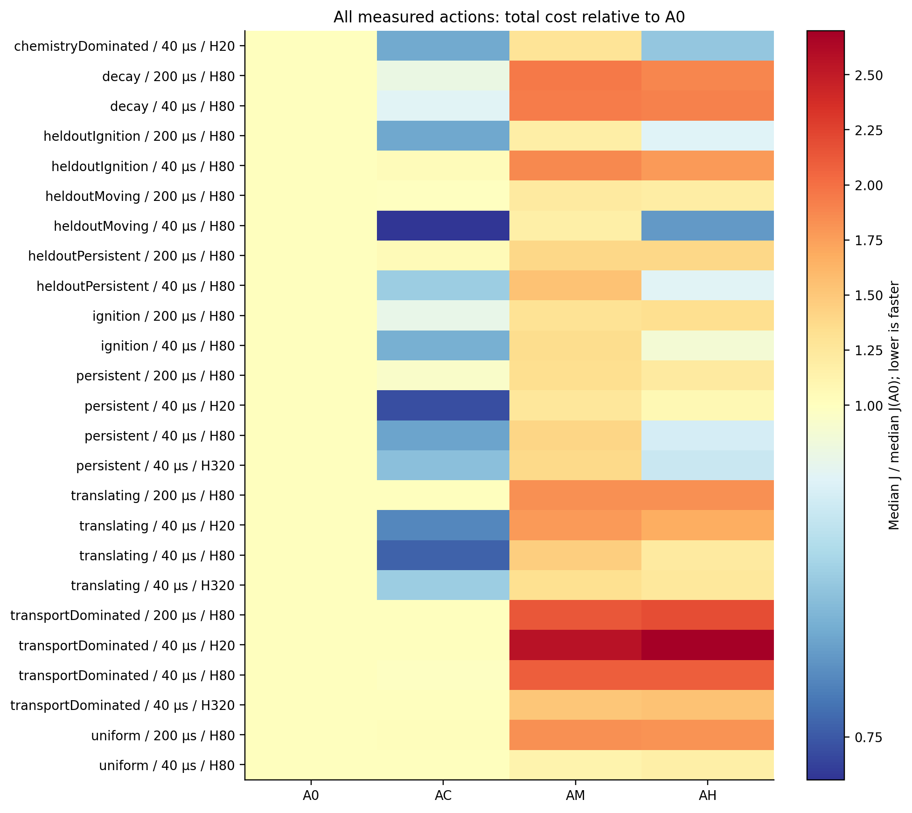

Data: [10_all_action_costs.source.json](10_all_action_costs.source.json)

## 11. 11_strong_scaling

Five trials per configuration on one six-core WSL2 host. Per-case decomposition is recorded separately. This is a small-domain, single-node experiment, not network scaling.

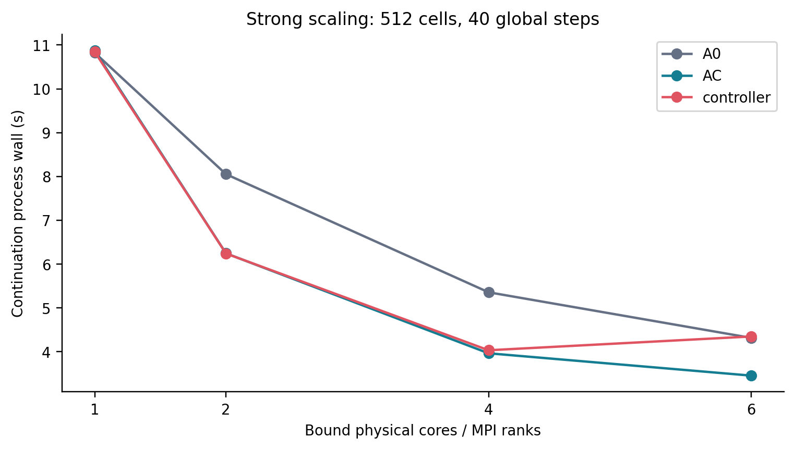

Data: [11_strong_scaling.source.json](11_strong_scaling.source.json)

## 12. 12_parallel_efficiency

Five trials per configuration on one six-core WSL2 host. Per-case decomposition is recorded separately. This is a small-domain, single-node experiment, not network scaling.

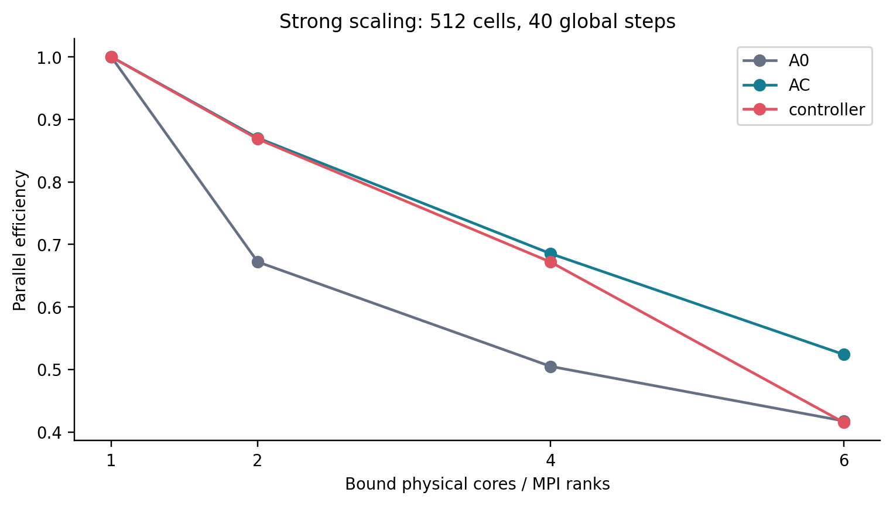

Data: [12_parallel_efficiency.source.json](12_parallel_efficiency.source.json)

## 13. 13_speedup_intervals

Pointwise 95% bootstrap intervals for independent median ratios (4000 resamples), five trials each. Multiple state selection is exploratory; intervals are not simultaneous or confirmatory.

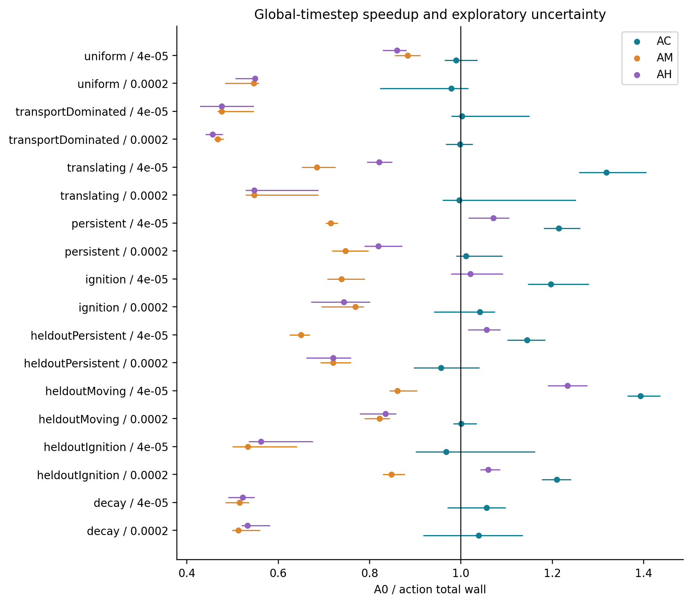

Data: [13_speedup_intervals.source.json](13_speedup_intervals.source.json)

## 14. 14_faces_vs_weight

Native redistributed mesh face counts, including cyclic processor interfaces. Weight clipping is fixed at [0.1,10]; stronger weighting need not change an integer partition monotonically.

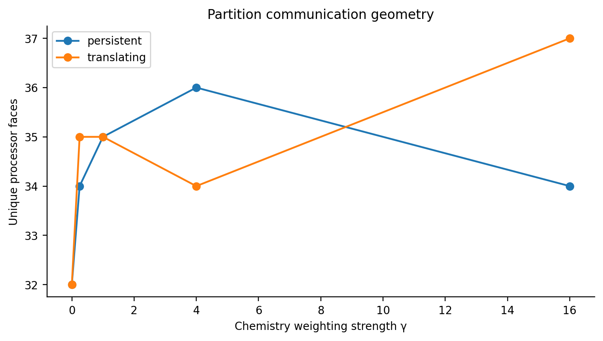

Data: [14_faces_vs_weight.source.json](14_faces_vs_weight.source.json)

## 15. 15_mpi_call_time

PMPI calls on the persistent condition. These durations include imbalance-induced waits; they are not pure network transfer times. No extra barriers or collectives are added by the profiler.

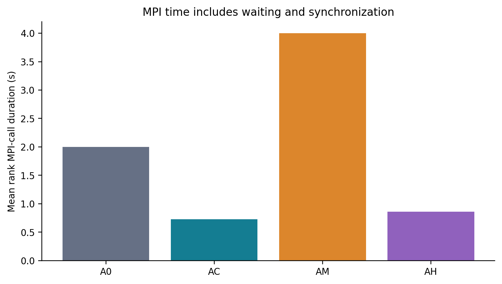

Data: [15_mpi_call_time.source.json](15_mpi_call_time.source.json)

## 16. 16_persistence_correlation

Actual future costs are used only for this diagnostic. Controller inputs use previous and current costs. Timing noise and reaction evolution both affect correlations.

Data: [16_persistence_correlation.source.json](16_persistence_correlation.source.json)

## 17. 17_prediction_accuracy

Coefficients fit on five entire training conditions; two whole validation conditions set conservative residual margins; three held-out conditions are untouched by fitting. Setup costs are excluded from this solver-delta plot.

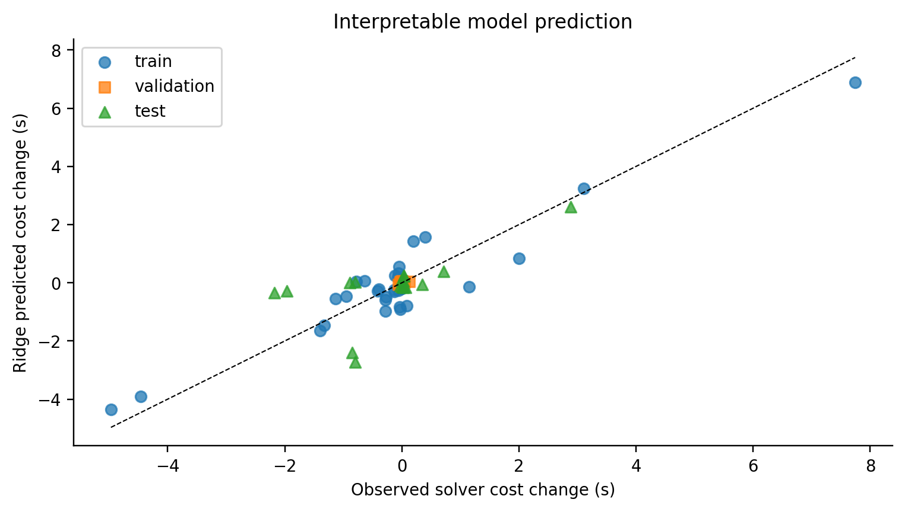

Data: [17_prediction_accuracy.source.json](17_prediction_accuracy.source.json)

## 18. 18_confusion_matrix

Median oracle labels can change within runtime noise. This matrix covers six held-out checkpoint states, not independent flow trajectories.

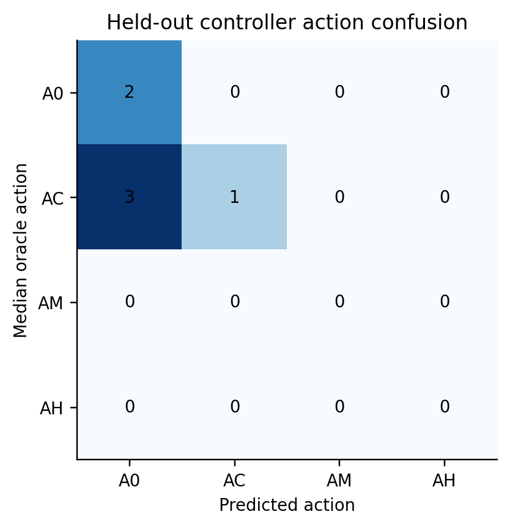

Data: [18_confusion_matrix.source.json](18_confusion_matrix.source.json)

## 19. 19_controller_regret

Retrospective regret includes measured feature extraction for feature-driven policies. This is distinct from independent deployment and live end-to-end timings.

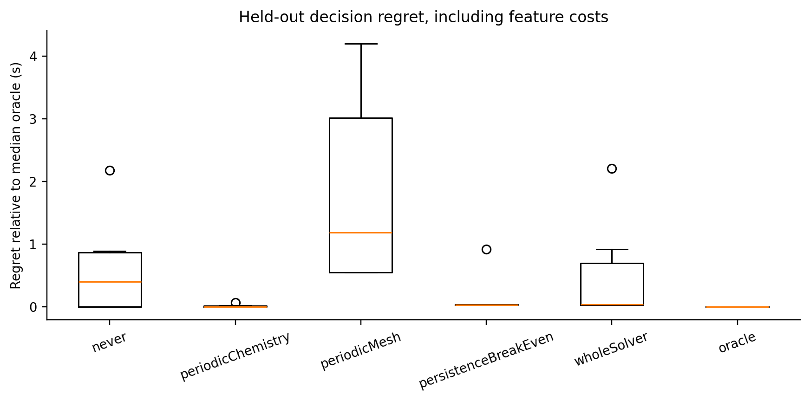

Data: [19_controller_regret.source.json](19_controller_regret.source.json)

## 20. 20_cumulative_runtime

Repeat-zero measured rollout. All policies reach 280 μs. Dashed AM fails the predefined endpoint field gate and is descriptive timing evidence only. Uninterrupted arms provide an endpoint only; no interpolated cumulative clock is invented. No trial is removed.

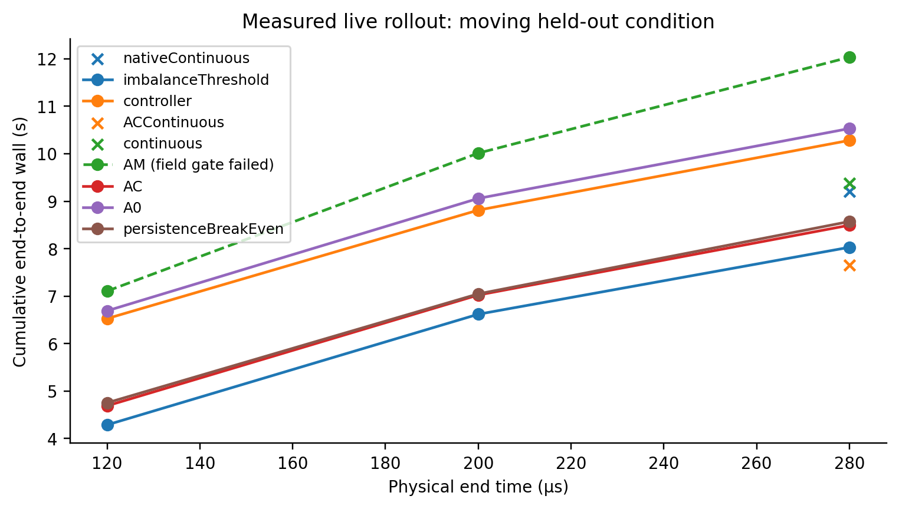

Data: [20_cumulative_runtime.source.json](20_cumulative_runtime.source.json)

## 21. 21_rebalancing_events

Three actual rollouts per condition; features come only from the completed prefix of that same rollout. The frozen model has a forty-step cooldown.

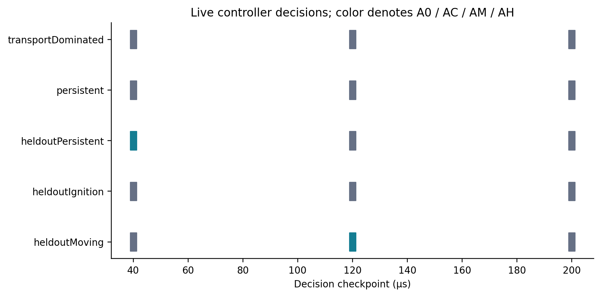

Data: [21_rebalancing_events.source.json](21_rebalancing_events.source.json)

## 22. 22_predicted_benefit

Benefits are solver deltas before action setup and residual safety margins. Prediction error is reported even when the controller declines to act.

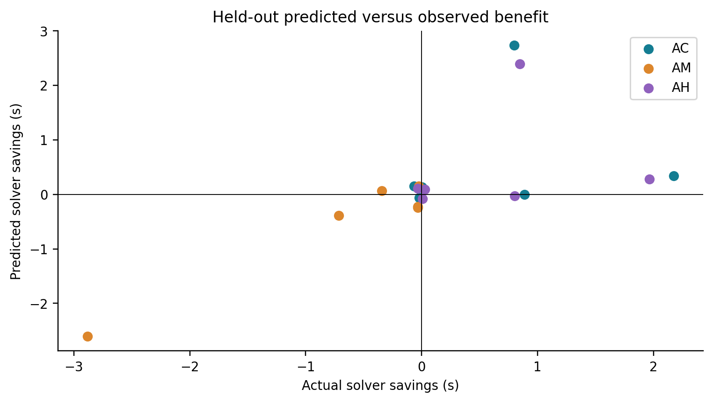

Data: [22_predicted_benefit.source.json](22_predicted_benefit.source.json)

## 23. 23_oracle_controller_comparison

Aggregate ratios sum checkpoint median costs. Conditional 95% intervals resample runs within the same fixed test states, retaining frozen choices and observed oracle labels. They exclude model-fitting and case-population uncertainty. The hindsight oracle remains optimistic and is not executable online.

Data: [23_oracle_controller_comparison.source.json](23_oracle_controller_comparison.source.json)

## 24. 24_ablations

Features are omitted according to documented variants. The initial communication feature is constant across same-grid states, so noCommunication cannot establish communication-model usefulness. EMA denotes a two-snapshot blend.

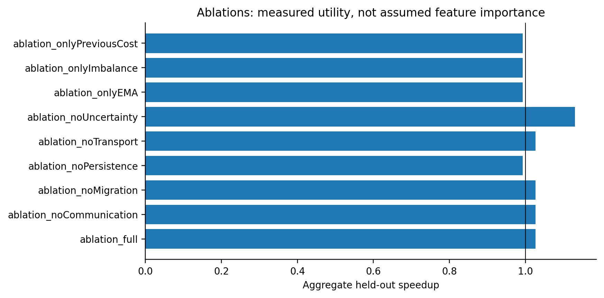

Data: [24_ablations.source.json](24_ablations.source.json)

## 25. 25_regime_map

Marker size reflects the bounded past-cost lifetime estimate. Black outlines flag A0 or winner intervals crossing unity. No fitted boundary or unobserved winning region is imposed.

Data: [25_regime_map.source.json](25_regime_map.source.json)

## 26. 26_mass_conservation

Native thermodynamic inventory uses stored h and rho when available. Total energy is ∑ρV(h+hc+|U|²/2)−∑pV. Agreement between actions does not establish physical conservation or mesh/timestep convergence.

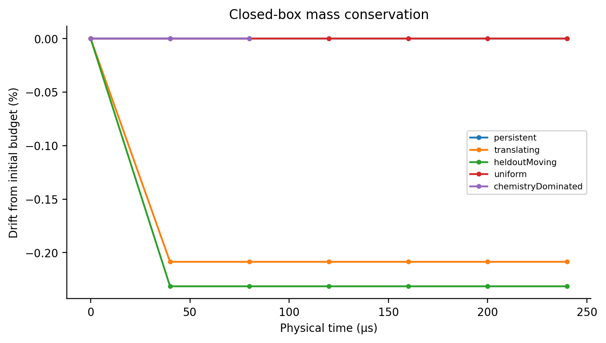

Data: [26_mass_conservation.source.json](26_mass_conservation.source.json)

## 27. 27_energy_conservation

Native thermodynamic inventory uses stored h and rho when available. Total energy is ∑ρV(h+hc+|U|²/2)−∑pV. Agreement between actions does not establish physical conservation or mesh/timestep convergence.

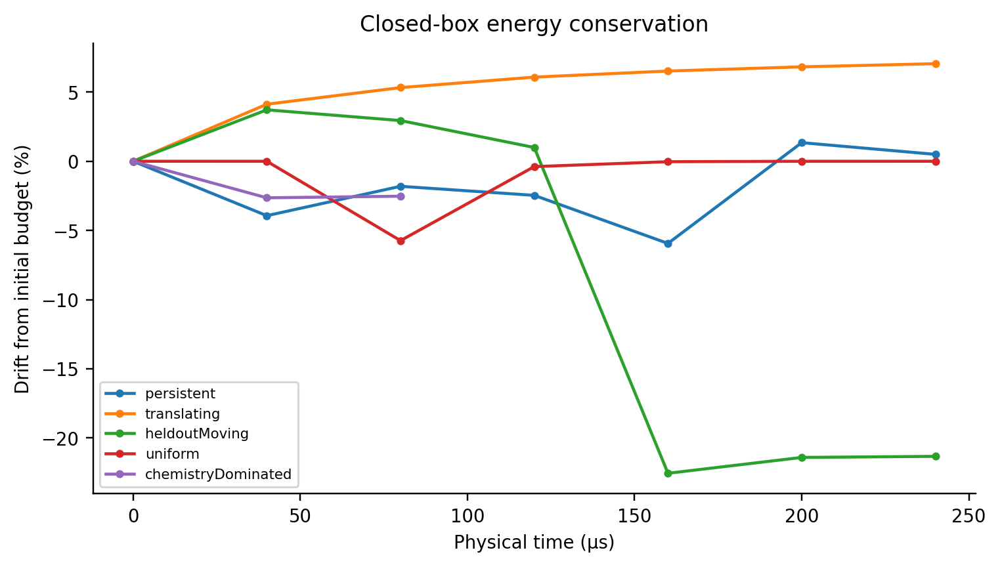

Data: [27_energy_conservation.source.json](27_energy_conservation.source.json)

## 28. 28_timestep_refinement

Each grid uses its own 0.5 μs reference, which is not an exact solution. Spatial refinement and heat-release changes remain limitations for physical flame interpretation.

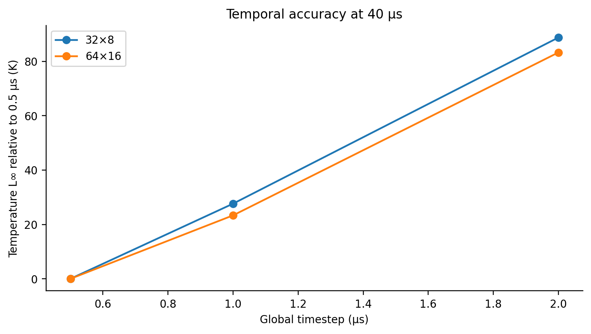

Data: [28_timestep_refinement.source.json](28_timestep_refinement.source.json)

## 29. 29_fine_timestep_actions

Five trials per action. Eight times more physical steps over the same continuation duration; still the original coarse grid and hence not a validated resolved-flame benchmark.

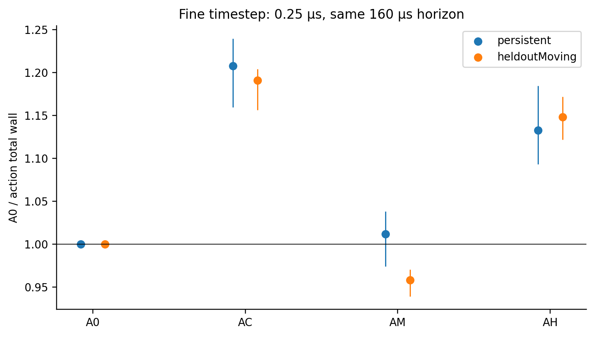

Data: [29_fine_timestep_actions.source.json](29_fine_timestep_actions.source.json)

## 30. 30_migration_horizon

Net measured benefit includes the native redistribution process. No extrapolated crossing is called observed. Future work may change the compute and communication penalties.

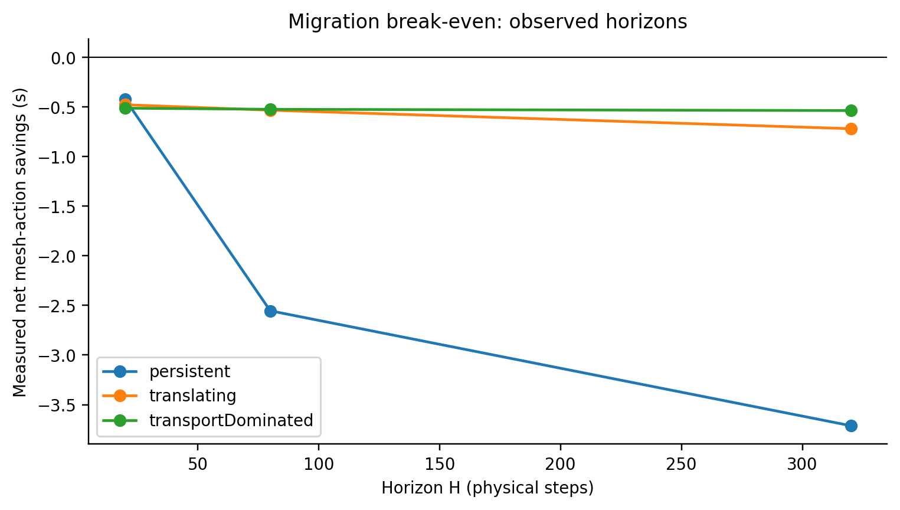

Data: [30_migration_horizon.source.json](30_migration_horizon.source.json)

## 31. 31_chemistry_fraction

Rank means over the last five physical steps. Synchronized nonchemistry phases can contain chemistry imbalance waits; this ratio is explanatory, not an Amdahl bound.

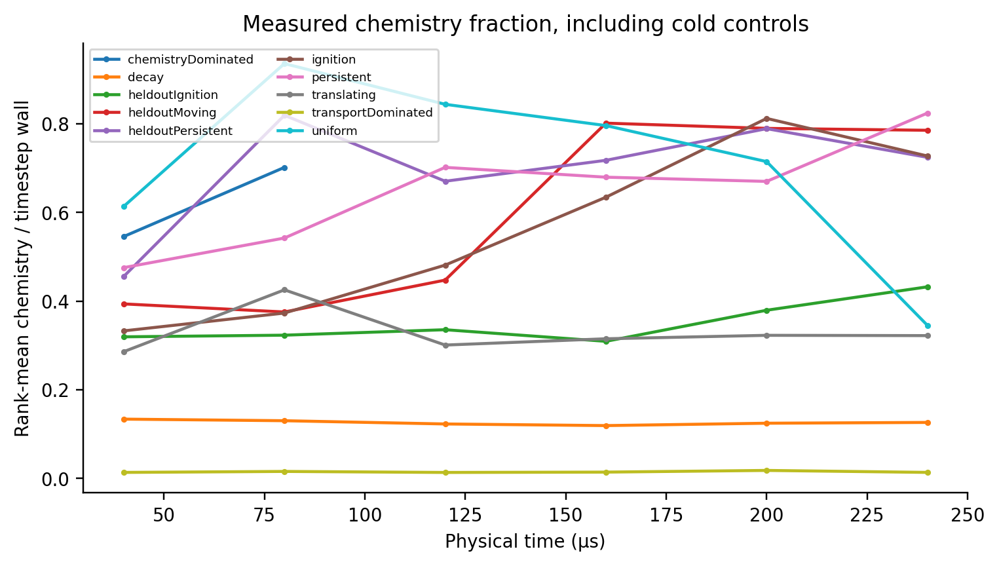

Data: [31_chemistry_fraction.source.json](31_chemistry_fraction.source.json)

## 32. 32_linear_iterations

Iteration counts parsed from native solver logs. Counts alone do not identify cache misses or pure halo-communication cost.

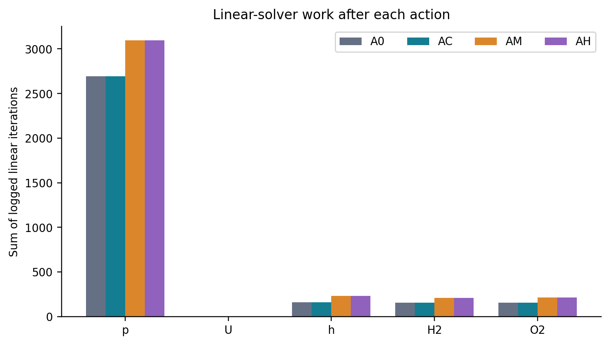

Data: [32_linear_iterations.source.json](32_linear_iterations.source.json)

## 33. 33_architecture

Architecture: chemistry tasks are offloaded inside the compatible Stuttgart library; mesh migration is native redistributePar between solver processes.

Data: [33_architecture.source.json](33_architecture.source.json)

## 34. 34_methodology

Methodology preserves held-out conditions and distinguishes retrospective oracle labels from executed controller decisions.

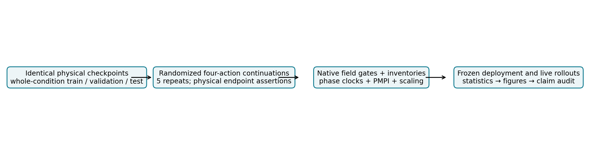

Data: [34_methodology.source.json](34_methodology.source.json)

## 35. 35_quicklb_reproduction

Public version 0.02 on a 30×30 Gray–Scott kernel with SciPy BDF, four ranks, ten steps, three repeats. This reproduces library execution, not the INCA Spray-A performance paper.

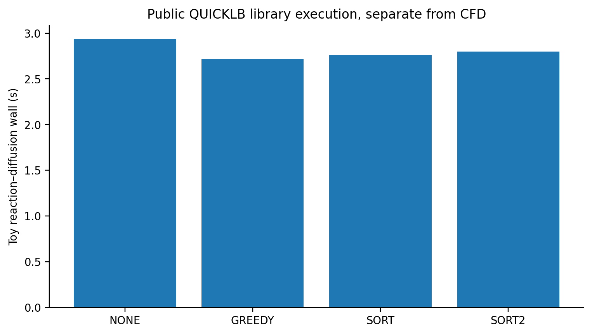

Data: [35_quicklb_reproduction.source.json](35_quicklb_reproduction.source.json)

## 36. 36_model_acquisition_cost

Acquisition lower bound sums actual train/validation trial costs; it additionally excludes shared history generation, experiment duplication and postprocessing. Offline training is not free merely because ridge fitting is fast.

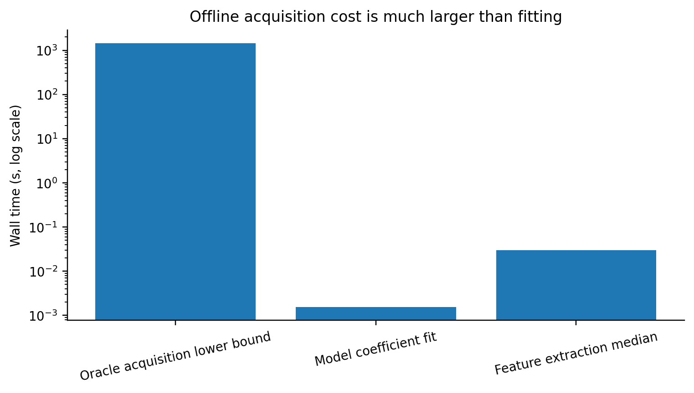

Data: [36_model_acquisition_cost.source.json](36_model_acquisition_cost.source.json)

## 37. 37_profiling_overhead

Three randomized on/off trials per action. Main performance claims use profiling off; this small calibration cannot resolve sub-percent overhead.

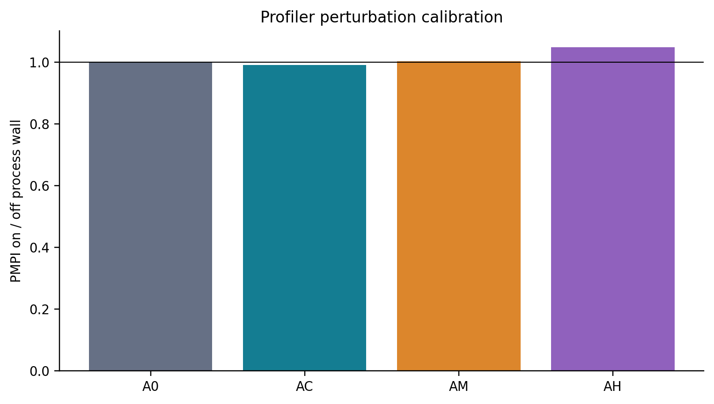

Data: [37_profiling_overhead.source.json](37_profiling_overhead.source.json)

## 38. 38_oracle_margin_noise

A median winner does not establish a statistically separated action. CV and margin are different statistics; this plot flags weak separation without fabricating an oracle confidence bound.

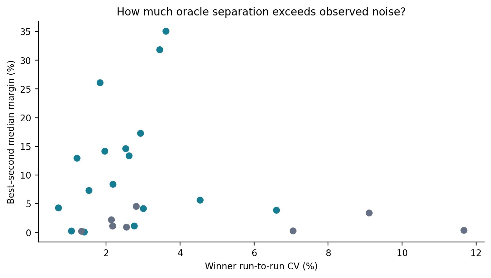

Data: [38_oracle_margin_noise.source.json](38_oracle_margin_noise.source.json)

## 39. 39_species_normalization

Every major action is checked against the same-repeat A0 endpoint. Exact zeros are displayed at 1e-17 to permit the logarithmic axis; raw values are retained. Species positivity and per-field scales are checked separately; normalization alone is insufficient.

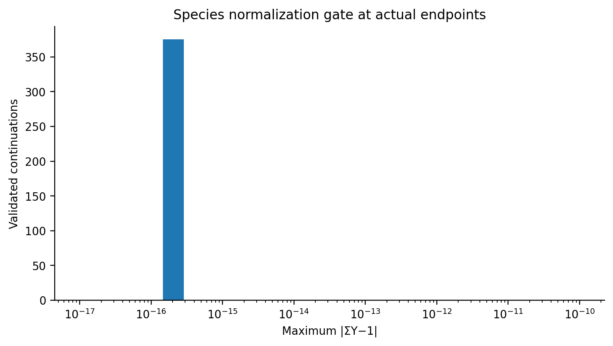

Data: [39_species_normalization.source.json](39_species_normalization.source.json)

## 40. 40_deployment

Five independent trials per policy. Controller feature extraction, inference and action setup are actually timed and charged. Training/validation data only fit the frozen model before this campaign.

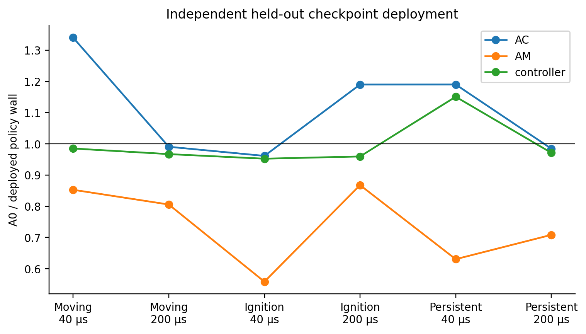

Data: [40_deployment.source.json](40_deployment.source.json)

## 41. 41_controller_phase_profile

Three profiled controller executions in each representative condition, with paired profiling-off trials and field gates. Feature extraction and inference are separately charged; rank phase sums include synchronization and are not additive critical-path estimates.

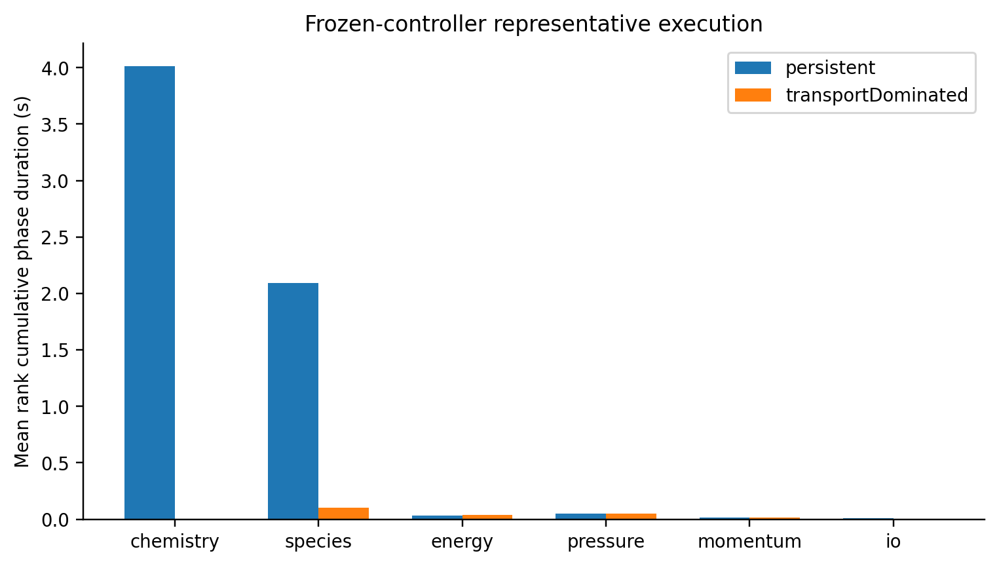

Data: [41_controller_phase_profile.source.json](41_controller_phase_profile.source.json)

## 42. 42_independent_confirmation

Preselected moving positive and uniform negative conditions, twenty new randomized trials per action. No model refit or test-margin tuning. Same checkpoint 40 μs and 160 μs continuation, four ranks, 256 cells; complete action and process costs.

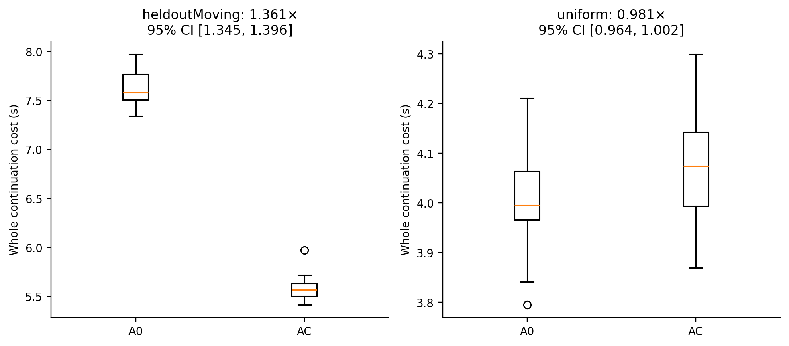

Data: [42_independent_confirmation.source.json](42_independent_confirmation.source.json)

## 43. 43_transport_consequence_model

Training uses whole training conditions only. Geometry is observed after actual partitioning and is not a free deployed-controller input. Transport duration includes synchronization effects; this is not an identifiable network-time predictor.

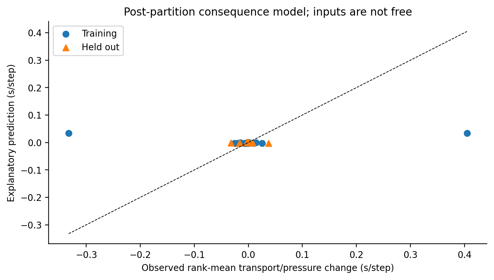

Data: [43_transport_consequence_model.source.json](43_transport_consequence_model.source.json)

## 44. 44_conservation_diagnosis

Seven independent physical-accuracy pilots plus two matched fine-time/four-pressure-corrector controls, following a nonconvergent moving-condition energy budget. Point/line distinctions identify grid, pressure-correction and PIMPLE outer-coupling changes; these are diagnostics, not controller tuning or an exact conservation reference.

Data: [44_conservation_diagnosis.source.json](44_conservation_diagnosis.source.json)

## 45. 45_mpi_consequence_model

Two training conditions, one entirely held-out moving condition, three profiled repeats per action. Post-partition inputs are measured and not free online features. MPI-call durations do not identify pure network-transfer cost; independent physical sample size remains small.

Data: [45_mpi_consequence_model.source.json](45_mpi_consequence_model.source.json)

## 46. 46_live_mesh_numerical_controls

Each control uses the same observed post-migration physical checkpoint and fixed mesh ownership. Original timestep, finer global timestep and tighter ODE tolerance are compared with matching A0 controls. The original rejected trial remains in the dataset; thresholds are unchanged and these controls do not replace its timing. Exact-zero normalized errors are displayed at 1e-12 for the logarithmic axis.

Data: [46_live_mesh_numerical_controls.source.json](46_live_mesh_numerical_controls.source.json)

## 47. 47_mapped_flux_audit

Stored mass-flux divergence is compared with A0 on canonical cells, along with flux divergence reconstructed from equivalent cell rho/U. Cell-centre differences are retained in the source data. A symmetric-log axis is linear within 1e-8 of zero; no values are replaced. These observations localize discrepancies and do not by themselves prove a corrected migration algorithm.

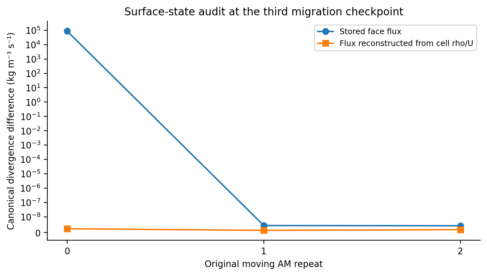

Data: [47_mapped_flux_audit.source.json](47_mapped_flux_audit.source.json)

## 48. 48_initial_coefficient_mass

A separate diagnostic executable preallocates initial psi.oldTime before the first thermodynamic update; two steps at each of two global timesteps locate the mass offset. The original oracle/controller executable and dataset are unchanged. This initialization check does not establish long-time energy or flame convergence.

Data: [48_initial_coefficient_mass.source.json](48_initial_coefficient_mass.source.json)

## 49. 49_flux_preservation_controls

Separate controls preserve source flux on exact observed ownership maps or restore the exactly zero coupled copy from its existing nonzero periodic partner. Every delivered control passes the original full-field gate; original failed timings remain rejected. All values are positive and displayed without clipping; utility launch costs are retained. Axis-aligned stationary geometry only; the snapshot utility uses global face storage and is not a scalable general-purpose mapper.

Data: [49_flux_preservation_controls.source.json](49_flux_preservation_controls.source.json)

## 50. 50_live_heldout_costs

Three original trials in each of three held-out conditions. Ratio of summed condition medians includes preprocessing, decomposition, prefix, controller decisions, migration and every continuation. Conditional 95% intervals resample runs within those fixed conditions and do not estimate a population of flows. The hatched mesh ratio is descriptive only: its original numerical gate failed. No failed trial is removed or replaced by a repair control.

Data: [50_live_heldout_costs.source.json](50_live_heldout_costs.source.json)

## 51. 51_full_history_initialization

Two full moving-condition histories use the separate initialization-only executable: original 2 μs / one pressure corrector and 0.03125 μs / four pressure correctors. The mass offset is removed throughout; residual energy drift quantifies a distinct limitation. These differ in timestep and pressure coupling and are not a single-variable convergence sweep. Original frozen performance data are unchanged.

Data: [51_full_history_initialization.source.json](51_full_history_initialization.source.json)