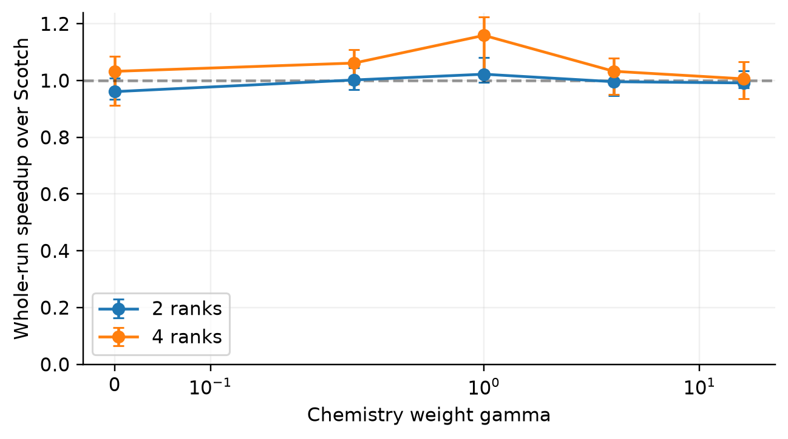
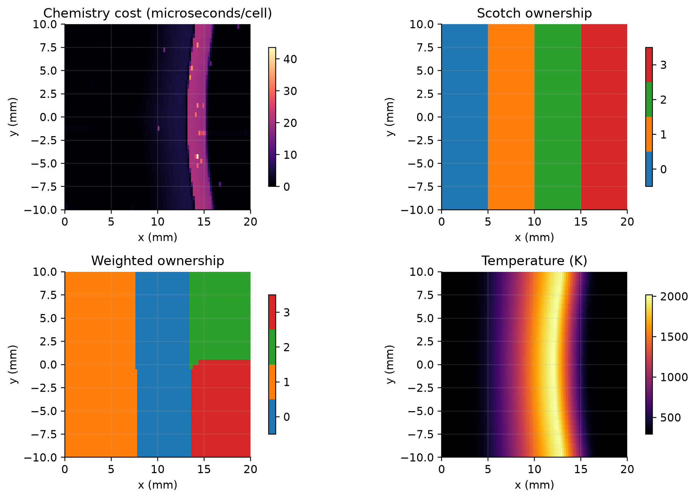

# Physics-Aware Domain Decomposition for Reactive OpenFOAM

Research artifact, 2026-10-04. Evidence labels distinguish VERIFIED source/numerics, IMPLEMENTED software, TESTED behavior, MEASURED timing, DERIVED analysis (an INFERRED result computed from measurements), PARTIALLY TESTED generalizations, PROPOSED/FUTURE WORK and UNSUPPORTED claims.

## Abstract

**MEASURED:** Static chemistry-derived Scotch weights reduce whole solver process time in one persistent, reduced-chemistry OpenFOAM benchmark. On four bound Ryzen 5 5600X cores in a WSL2 guest, gamma=1 gives a median 1.159× speedup over conventional Scotch, with a pointwise bootstrap 95% interval [1.030, 1.223] across five trials. Chemistry max/mean rank time falls from 3.112 to 1.803. This exploratory best result excludes predictor-training and decomposition cost. A fixed global-timestep sensitivity run is neutral within timing uncertainty. With chemistry disabled but stale reactive weights retained, gamma=16 increases wall time by 48.5%. The original faster loose-tolerance result is rejected because its temperature differs by 12.14 K. The accepted strict comparison differs by only 4.31e-7 K. The result is evidence of a limited useful regime, not a universal gain, dynamic-repartitioning result, or superiority to chemistry-task balancing.

## 1. Research question

Can chemistry-derived cell weights improve total reactive-flow execution time after accounting for transport ownership, communication, numerical equivalence and collection/setup cost? The local experiment answers the static persistent-region question. It does not answer whether mesh weighting outperforms an equivalent DLBFoam/task scheduler: that baseline was unavailable on this OpenCFD installation.

## 2. Background

**VERIFIED:** Equal cell counts need not imply equal chemistry cost. Mesh partitions also determine transport matrix distribution and processor patches. Chemistry-task scheduling changes the unit of work without moving transport cells. A weighted mesh can reduce reaction work on the slow rank while increasing transport work there. Timing phases containing MPI waits can appear balanced even when compute is not.

## 3. Related work

Weighted graphs, chemistry-aware mesh partitioning, previous-step cost prediction, task redistribution, adaptive repartitioning, core lending and heterogeneous chemistry all have prior art. The [literature review](literature_review.md), [machine-readable 26-source records](literature.json), [bibliography](references.bib) and [claim checks](claim_verification.md) state access levels and distinguish full papers from abstracts or metadata. Fluent officially documents chemistry/ISAT mesh weights; installed v2012 already exposes weights. No claim of general novelty for static weighting or previous-step prediction is defensible. No unmatched published speedup is used as a baseline.

## 4. OpenFOAM architecture

**VERIFIED:** OpenCFD OpenFOAM-v2012, build _7bdb509494-20201222, double precision and 32-bit labels. The [Phase A source audit](phaseA_repository_audit.md) records exact installed paths and call graph; [machine manifest](../data/machine.json) hashes relevant upstream source.

reactingFoam calls laminar combustion correction from YEqn.H, which calls StandardChemistryModel and EulerImplicit for the tutorial thermo. The tutorial's unused odeCoeffs are not proof that Rosenbrock43 runs. decomposePar's domainDecompositionDistribute.C reads a selected-time volScalarField named by weightField, and Scotch converts cell weights to integer graph weights. The utility and graph algorithm are native and unmodified.

Scotch 6.0.9 and KaHIP decomposers are compiled. Underlying PT-Scotch headers/libraries exist, but an OpenFOAM PT-Scotch runtime was not compiled here. Native METIS/ParMETIS and local DLBFoam were unavailable. redistributePar/fvMeshDistribute exist, but live chemistry/PIMPLE state migration was not implemented.

## 5. Methodology

**MEASURED/TESTED:** All performance campaigns run sequentially on one WSL2 guest; no cluster jobs, GPU computation or oversubscribed solver experiments. Guest: 6 physical/12 logical Ryzen cores, about 15 GiB memory. OpenMPI 4.0.3; GCC 6.3, -O3, DP/Int32; OMP_NUM_THREADS=1. Final strict runs use mpirun --bind-to core --map-by core --nooversubscribe --report-bindings. Placement and detected governor are retained. The host remains a shared desktop, so background activity/frequency noise is not eliminated.

The primary matrix uses 1/2/4 solver ranks; simple, unweighted Scotch, uniform weights, and gamma in {0.25,1,4,16}; five randomized repeats per configuration. This gives 75 strict runs. A separate 75-run loose matrix is preserved but its weighted physics result is rejected. Serial predictor training: 80 LTS iterations; weights use the median cell clocks over iterations 61–80. Timed continuations start at iteration 80 and finish at 160. The first 10 iterations and final output iteration are excluded only from steady timer summaries (69 steps); whole process wall retains startup and output.

Whole process wall is measured with a monotonic Python clock around a blocking child wait. An earlier pilot used coarse timeout polling and is excluded from primary timing inference. Early serial training/pilots were unbound; corrected manifests preserve the original mapping claim and identify actual placement from logs.

Sample standard deviation and min/max are reported; CV uses population standard deviation divided by mean. Intervals resample independent trial medians 5000 times with deterministic seed 7349. Gamma selection is exploratory: intervals are pointwise, not adjusted for selection. A held-out repeat campaign is needed before claiming a robust optimum.

## 6. Workload model

**IMPLEMENTED/TESTED:** Let q_i be measured chemistry seconds per cell, or the cheap substep proxy for analysis. The implemented normalized composite is

w_i = clip((1 + gamma q_i/mean(q))/(1 + gamma), w_min, w_max),

with default bounds [0.05,100]. Zero mean cost gives uniform weights. Normalization precedes clipping; clipping can change the final mean, so it is not renormalized afterward. alpha is exposed for exponential smoothing. Existing chemCost history is preserved across serial/decomposed restarts; alpha=0 holds the loaded history fixed. Invalid alpha, negative trace interval and invalid history are rejected.

The transport contribution is a uniform cell floor. Measured spatial transport/communication coefficients are **FUTURE WORK**. gamma=1 roughly balances the normalized chemistry term and the cell floor; it is not an experimentally fitted physical constant.

Synthetic models cover uniform, Gaussian, slab, half-domain, multiple spots and extreme skew on a 2D cross-section. Distribution parameters are explicit in the matrix script and the models API. Moving spots are an offline derived sensitivity on native partitions, not a moving reacting-flow simulation.

## 7. Implementation

**IMPLEMENTED/TESTED:** [reactingFoamPAD](../applications/reactingFoamPAD/) is a user-space solver copy with fixed-enum exclusive steady-clock timers. It measures density, momentum, chemistry, species, energy, pressure, turbulence, output and complete timestep intervals. Rank-local CSV is buffered; no timing reductions or barriers are added to reactive solves. Step timing includes control/rDeltaT updates and native write, but excludes CSV row emission and printExecutionTime. Whole process wall includes all overhead.

[costChemistry](../src/costChemistry/) registers costEulerImplicit for only the benchmark's StandardChemistryModel/psiReactionThermo/gasHThermoPhysics combination. It copies the exact upstream integration-loop numerical operations, calls unchanged EulerImplicit cell solves, and adds optional clocks, substep counts and traces. chemCost and chemSubsteps are passive diagnostic fields. It is not a general ODE/Jacobian counter implementation.

[padWorkloadFoam](../applications/padWorkloadFoam/) executes synthetic trigonometric CPU work and verified coupled processor halos. Its intentional step barrier belongs only to the controlled synthetic test. Synthetic timing is never presented as reactive CFD performance.

Python drivers preserve cases, logs, dictionaries, partition addressing, run manifests and CSVs. Field parsers reject malformed counts/nonfinite values. Build source and binary hashes are recorded separately. The smoothing-restart constructor correction followed the performance campaign; its benchmarked predecessor is retained at data/raw/build/costEulerImplicit_benchmarked.H. Primary timed continuations use the ordinary chemistry solver; alpha=1 training arithmetic is unchanged.

## 8. Verification

**VERIFIED for tested configurations:** Same-partition stock versus instrumented and cost-instrumented output matches exactly in serial and two ranks. Residual histories match. Fresh final smoke also compares native thermo.rho and sensible enthalpy h. Native T,p,U and five-species probe histories at three interior points match for 10 iterations in all four serial/parallel/cost combinations. Thirteen component tests pass; serial and decomposed EMA restart tests pass; invalid settings are rejected.

The strict four-rank gamma=1 partition comparison yields:

| Field | L_infinity difference | Relative L2 |
|---|---:|---:|
| T | 4.308e-7 K | 9.959e-11 |
| p | 1.001e-8 Pa | 2.115e-14 |
| U | 8.209e-10 m/s, component maximum | 9.643e-10 |
| CH4 | 4.818e-10 | 1.414e-10 |
| Qdot | 0.9136 W/m3 | 1.297e-9 |
| rho | 2.978e-10 kg/m3 | 8.368e-11 |
| h | 9.499e-4 J/kg | 1.648e-10 |

All strict and chemistry-disabled reconstructed repeat-0 comparisons pass the reported norm gate. [Full field norms](../data/processed/numerical_norms.csv), [best comparison](../data/processed/tight/partition_validation_p4_scotch_g1.json).

The original componentwise criterion is retained as pointwisePass. The final norm criterion is Linf <= atol + rtol*referenceLinf, with atol=1e-5 and rtol=1e-4 for changed partitions. This change followed the near-zero transient Qdot failure and is disclosed, not presented as a pre-registered gate. The fixed dt=1e-6 s, 80-step comparison has T Linf=1.609e-5 K and Qdot Linf=81.31 W/m3, relative L2=1.194e-7; its Qdot pointwise check fails near zero while the field-scale check passes. The original pointwise JSON is preserved.

Native density gives total-mass relative difference 4.70e-11, sensible-enthalpy-plus-kinetic inventory difference 1.20e-10, and heat-release-integral difference 4.79e-11 for the accepted pair. Species bounds, sum(Y), species-mass and elemental inventories are recorded. sum(Y) error is below 1.8e-14 for that pair. These are **cross-solution inventory checks**, not proof of temporal conservation. The tutorial has open boundaries and LTS; no closed boundary-flux energy/mass budget was performed. Native h is sensible enthalpy, not total internal energy.

## 9. Synthetic benchmarks

**MEASURED native partitions / INFERRED workload sums:** 2920 full-matrix records span 32x16 and 64x32 meshes, ranks 1/2/4/8/12, Gaussian amplitudes 0/1/2/5/10/20/50, widths 0.07/0.15/0.30 and edge/boundary/center locations; additional distributions and simple/Scotch comparisons are retained. Ranks 8/12 are decomposition-only, and 24 was excluded because hardware did not support it. Native cell centres are checked against the structured mesh. Weights surviving decomposition are verified. Baseline decompositions are cached; cached timing references are not independent repeated trials. [Matrix CSV](../data/processed/synthetic.csv)

Longest-processing-time assignment supplies a **near-ideal greedy work-only baseline**, not an exact optimum; it ignores adjacency/communication.

**MEASURED controlled CPU/halo work:** 320 original runs cover two resolutions, 2/4 ranks, four distributions, 1/32 halo passes, weighted/unweighted partitions, five repeats. Another 20 bounded runs test 2048 halo passes, following a four-run pilot. These use artificial CPU loops, not chemistry. The largest original synthetic step ratio is 1.789x for a half-domain case on two ranks (32x16, 32 halo passes), CI [1.634,2.476]. The original least favorable estimate is 0.773x for a uniform 64x32/four-rank case, CI [0.757,1.252], which does not establish a significant regression. [Runtime results](../data/processed/synthetic_runtime_summary.csv)

## 10. Reactive benchmarks

**VERIFIED provenance:** Public shipped counterFlowFlame2DLTS tutorial, 100x40x1=4000 cells; 20 mm x 20 mm cross-section with 20 mm extruded thickness and empty front/back patches. Uniform cell volume totals 8e-6 m3. Methane fuel and air oppose one another; outlet patches and all original initialization/BC/mechanism files are retained in each case and hashed in manifests. Five species: CH4/O2/CO2/H2O/N2; one reaction, EulerImplicit, laminar model, sensible enthalpy. This is reduced chemistry, not detailed combustion validation.

**MEASURED primary whole-run results:**

{TABLE_REACTIVE}

Best baseline median 2.01698 s, weighted median 1.74009 s: 13.73% less wall time, or 15.91% speedup. Baseline sample SD 0.09486 s, range 1.88104–2.10752; weighted SD 0.09701 s, range 1.69245–1.93186, CV 4.87%. Five-trial pointwise CI [1.030,1.223]. Final fields agree tightly. Training, cost construction and decomposition are excluded from this solver-only comparison.

At two ranks, gamma=1 gives only 1.022x and its CI includes one. At four ranks, gamma=4/16 produce substantially better predicted chemistry balance than baseline without a clear whole-run benefit. This is why a perfect chemistry partition is not the optimization objective.

**MEASURED fixed-global-dt sensitivity:** Five baseline and five gamma=1 runs yield 0.965x, CI [0.863,1.240]. The short transient confirms numerical agreement but does not confirm a performance gain. [Transient results](../data/processed/transient_summary.csv)

## 11. Scaling

**MEASURED:** Strict whole-run serial median is 2.64280 s. Unweighted Scotch speedup is 1.208 at two ranks and 1.310 at four; efficiencies 0.604 and 0.328. Weighted gamma=1 gives 1.235 and 1.519; efficiencies 0.617 and 0.380. This small case scales poorly on the tested machine. Launch, output, synchronization and small partitions matter. No weak scaling, multinode scaling or 8/12/24-rank solver result is claimed. [Scaling table](../data/processed/tight/scaling.csv)

## 12. Communication tradeoff

**MEASURED proxies / PARTIALLY TESTED causal attribution:** At the accepted four-rank optimum, unique processor faces fall from 120 to 116, but maximum neighbors rise from 2 to 3. gamma=16 has 115 faces and better predicted chemistry balance but almost unchanged total runtime. Faces alone cannot explain or optimize total cost. Chemistry ownership and transport work distribution matter. The measured repeat-0 exclusive profile has similar total chemistry time summed over ranks, while the critical rank chemistry duration falls; species-phase time summed over ranks decreases and pressure/energy time increases. Those latter phases include waiting, so this supports a workload/wait redistribution interpretation without proving MPI-only savings. Cache and linear-solver behavior remain possible causes, not measured causal proofs.

The controlled workload clocks halo exchange and barrier separately. Halo duration includes waiting for peers, not only network transfer. The added 2048-pass campaign provides:

{SYNTHETIC_COMMS}

For the Gaussian case, speedup falls from 1.422x at one halo pass (CI [1.089,1.490]) to 1.024x at 2048 passes (CI [0.830,1.271]); measured weighted halo duration rises from 0.433 ms to 2.905 ms. The high-pressure estimate is neutral within uncertainty, not proof of a regression. Campaigns were separate, which limits causal attribution. These intra-node synthetic samples expose sensitivity to communication pressure. They do not establish a universal physical-flow crossover or inter-node bandwidth model. No PMPI byte/message-volume capture or hardware perf profile was available. The measured native exclusive phase profile is retained in figure 27; species/pressure/energy times include communication and waiting.

## 13. Predictor quality and sensitivity

**MEASURED/INFERRED:** Serial cell-clock next-iteration spatial correlation is about 0.963. Smoothing alpha=0.5 yields median correlation 0.970 and alpha=0.25 about 0.970; alpha=0 gives 0.615. No solver-runtime benefit is claimed for smoothing; this is offline predictor sensitivity. Substep counters correlate with cost imperfectly and are not RHS/Jacobian counts. Lags 1/5/10/20 are retained. [Predictor](../data/processed/tight/predictor.csv), [smoothing](../data/processed/tight/smoothing.csv)

Clipping sensitivity uses four actual native decompositions. Default weights span 0.594–3.803 and give predicted chemistry imbalance 1.314; an upper clip of 2 worsens it to 2.060; upper 1.5 to 2.156; uniform weights to 2.676. Python construction median is about 0.696 ms for 4000 cells across 100 evaluations. Final mean can differ from one after clipping. These are partition effects, not repeated solver-speedup results. [Clipping data](../data/processed/clipping_sensitivity.csv)

A translated analytic hotspot on the fixed 64x32 partition loses spatial correlation and weighted balance as its center moves. At 0.02 domain lengths/iteration, weighted imbalance reaches 3.154 after 25 iterations. This supports the persistence mechanism in the model but is not a moving flame measurement. Partition seeds and alternate chemistry mechanisms were not swept.

## 14. Dynamic repartitioning decision

**FUTURE WORK:** No live solver repartition/migration implemented. The static gain is modest, absent in the short transient sensitivity and dependent on a persistent reaction zone. There is no measurement of moving reactive cost, migration state, dynamic triggers or migration overhead. Implementing live migration now would not be justified as a demonstrated improvement.

Native redistributePar/fvMeshDistribute is identified for a future bounded prototype. It must migrate fields, old-time states, chemistry history, thermo and PIMPLE dependencies and validate restart equivalence before any speedup claim. No online break-even conclusion is reported.

## 15. Performance model and cost accounting

**INFERRED:** max_r sum_i(transport_i + gamma chemistry_i), communication and synchronization compete. J=max compute + lambda communication + mu migration is a conceptual model; lambda/mu are not fitted here.

The accepted steady max-rank accumulated timer proxy falls from 1.51326 to 1.26990 s over 69 iterations, implying about 3.527 ms saved per iteration. This is an offline proxy, not an added globally synchronized timer.

Measured stand-alone training is 2.32008 s (earlier unbound serial tracing). Weighted decomposition median is 0.16383 s versus baseline 0.15510 s. Charging all training, construction and weighted decomposition against that steady saving gives an **indicative 705-iteration static setup horizon**. Charging only incremental decomposition/construction gives about 3 iterations, but ignores obtaining/updating the predictor. These bookends are not rigorous dynamic break-even estimates. If training is physics work both strategies require, only its incremental overhead should be charged; that complete paired end-to-end design is not measured. An isolated 80-iteration solve does not amortize a fresh stand-alone training run.

Instrumentation campaign: seven randomized 80-iteration trials per variant (42 runs). Timers +0.27%, counters +0.58%, cell clocks +0.94%; these small estimates overlap normal variability and are not established regressions. Full cell tracing adds 5.70%, a material cost. Disabled timing's negative estimate is noise. [Overhead table](../data/processed/tight/instrumentation_overhead.csv)

## 16. Hypotheses

| Hypothesis | Status | Evidence and limit |
|---|---|---|
| H1: heterogeneous physics weights reduce compute imbalance | TESTED locally | Synthetic work sums; chemistry imbalance 3.112 to 1.803 |
| H2: total gain depends on communication penalty | PARTIALLY TESTED | Controlled halo sensitivity and native phase profiles; no universal crossover |
| H3: persistence favors static weights | PARTIALLY TESTED | High trace correlation; derived moving spot loses balance, no moving flame |
| H4: useful previous-step prediction has a correlation threshold | UNSUPPORTED threshold | Accuracy measured; no controlled threshold or held-out generalization |
| H5: dynamic repartition amortizes only over persistent horizons | PROPOSED | Static arithmetic only; no live migration cost |
| H6: low chemistry fraction favors conventional Scotch | TESTED control | Deliberately stale weights regress when chemistry is disabled |
| H7: sufficiently skewed chemistry can yield speedup | TESTED reduced case | Accepted four-rank gain; no detailed-chemistry validation |

## 17. Negative results

**MEASURED and preserved:** Loose LTS apparent 1.265x is rejected on numerical grounds. Strong gamma approaches almost ideal predicted chemistry balance without improving total wall. Two-rank gains are uncertain. Short global-dt performance is neutral. With chemistry disabled, gamma=1 gives 0.864x and gamma=16 0.673x, CI [0.639,0.695], corresponding to 48.5% greater wall time. This is a stale-predictor failure, not the best achievable no-chemistry configuration. Cold training cost exceeds the savings of one measured continuation.

Failed builds/API attempts and pilot directories remain available. No failed result is silently substituted for an accepted run. Some synthetic negative estimates have wide intervals and are treated as noise-compatible.

## 18. Limitations

**PARTIALLY TESTED:** One small public reduced mechanism; one machine and WSL virtualization; short physical-time horizon; 1/2/4 solver ranks; serial Scotch; no true multi-node communication; no exact message/byte profile; no closed temporal conservation budget; no equivalent DLBFoam or external task-balancer execution; no independent confirmation of selected gamma; no partition-seed sweep; no alternate ODE mechanism; no trained transport-cost model; no dynamic migration; no GPU execution. PDF/metadata access limitations in the review constrain some related-work details. The system is a research-grade local prototype, not a certified general production extension.

## 19. Reproducibility

[Project README](../README.md) gives exact WSL/Linux commands and Windows plotting. From repository root:

```bash
bash research/physicsAwareDecomposition/scripts/reproduceStudy.sh --smoke
bash research/physicsAwareDecomposition/scripts/reproduceStudy.sh --full
```

Default smoke rebuilds and runs tests in a new UTC-stamped output root. Full runs bounded sequential local campaigns and retains all evidence; no cluster launch. PAD_OUTPUT_ROOT must be fresh, and run creation refuses overwrite. PAD_FOAM_ROOT selects the v2012 installation. This machine needs existing GCC/sysroot wrappers; another configured v2012 installation should set PAD_COMPILER_PATH to its normal compiler PATH. Build artifacts stay in this project.

Plotting requires the pinned requirements-plot.txt; the current Windows bundled runtime uses the installed project build/pydeps. PNG/PDF/SVG and source JSON accompany every figure. Benchmark repetition reproduces a design, not identical noisy timings. Component/unit, field, residual, probe and restart equivalence have been rerun in a fresh output directory. The finalized full wrapper has not been rerun as one entire duplicate campaign; each constituent stage was executed and final gates checked.

## 20. Related-work positioning

**INFERRED conservative assessment:** Useful contribution: exact-version user-space instrumentation/cost integration, retained numerical and performance failures, and a reproducible distinction between chemistry balance and total runtime. Static weights, Scotch, EMA, previous-cell costs and chemistry balancing are existing ideas. A strong paper needs deeper characterization and a fair task-only baseline, or a new validated transport/communication/persistence trigger. Do not market this prototype as a new graph partitioner or as superior to DLBFoam.

## 21. Conclusion and project status

The local evidence supports static weighting when a reaction zone persists and moderate weights preserve transport balance. More aggressive chemistry balancing can erase the gain. Numerical equivalence must precede performance acceptance; cold cost collection must be amortized. A universal useful-regime boundary remains unestablished.

{STATUS_TABLE}

## 22. Next three experiments

1. A longer fixed-global-timestep, detailed-chemistry persistent flame, with held-out gamma confirmation and at least ten repeats. The short transient's neutral result and exploratory LTS optimum motivate this.
2. An identical mechanism/integrator/fork task-only balancing baseline (port DLBFoam or implement a minimal compatible scheduler), comparing full end-to-end cost and native fields. The current external comparison gap prevents superiority claims.
3. A bounded moving reactive hotspot pilot on two nodes, measuring messages/bytes and complete native redistribution state/cost before testing a persistence-based trigger. Static movement and high-halo sensitivities motivate this; scale only after profiling a small pilot.

## References and evidence map

Use [references.bib](references.bib), [literature review](literature_review.md) and [claim verification](claim_verification.md). Exact new source/document/figure/table paths: [changed_files.txt](../changed_files.txt). Every retained project file: [artifact_inventory.txt](../artifact_inventory.txt). [Source manifest](../data/source_manifest.json), [evidence summary](../data/processed/evidence_summary.json), [figure captions](../figures/captions.md), raw campaign manifests/logs and [research log](research_log.md) complete the provenance chain.




