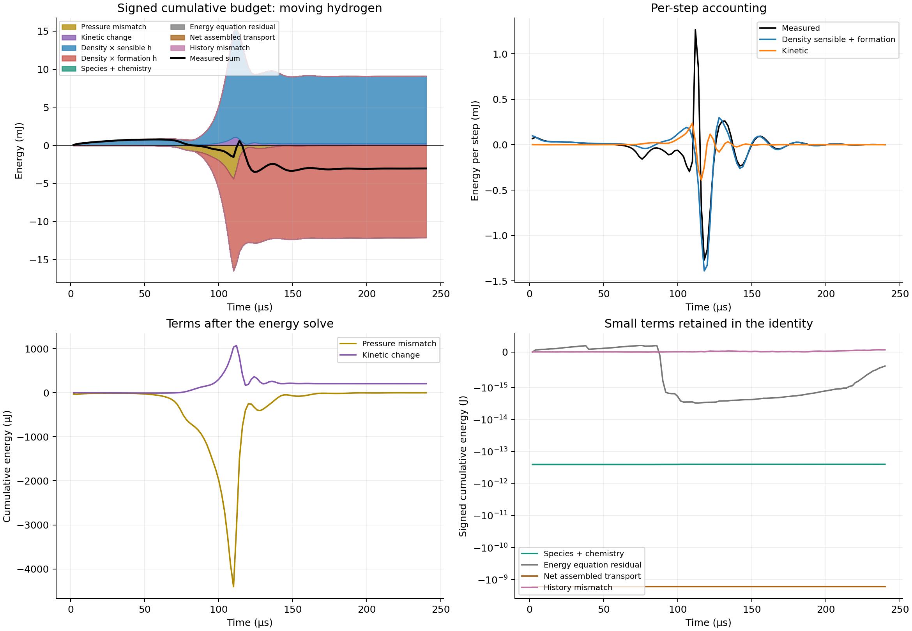
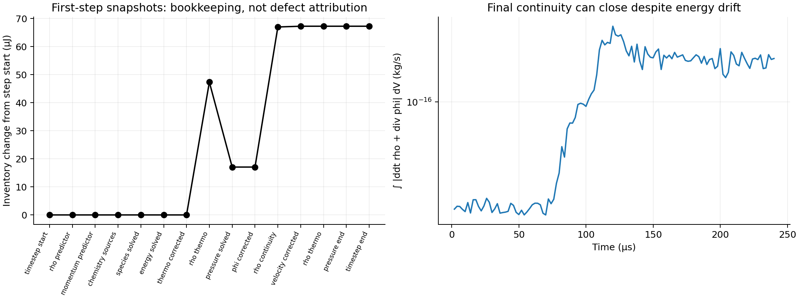
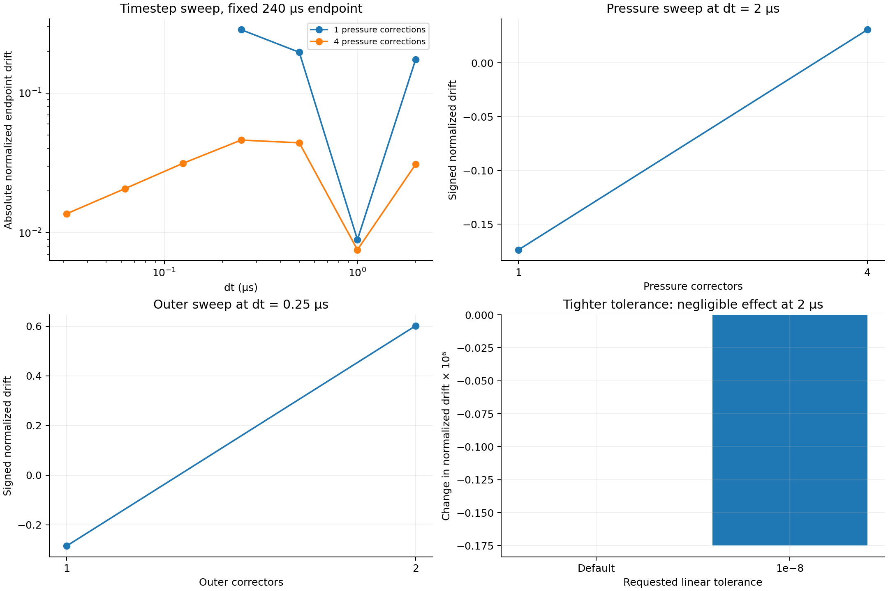
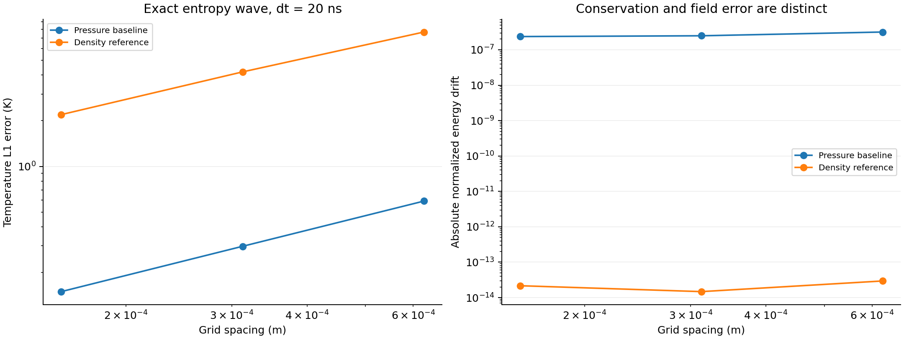
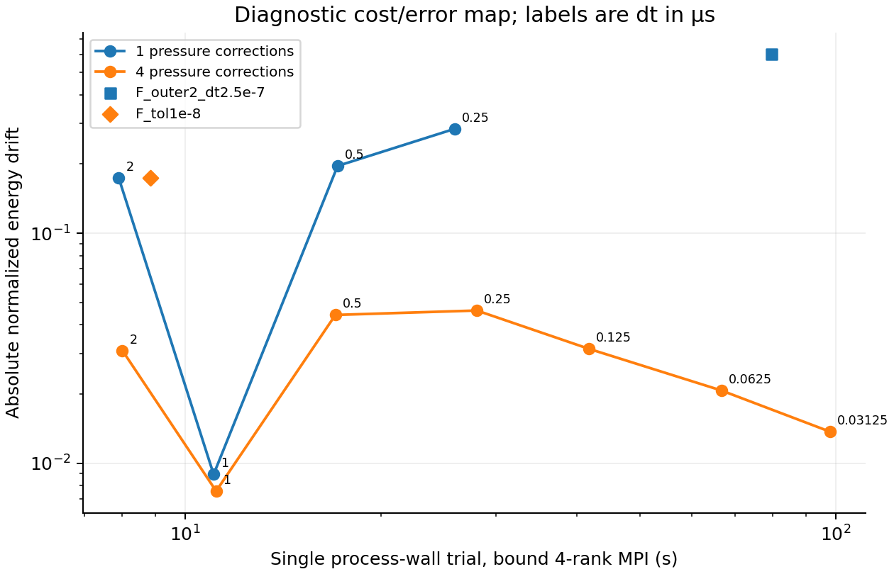

# Closed discrete total-energy audit: OpenCFD v2012

The first milestone is complete: the initialization-corrected moving hydrogen
case reproduces the published **−17.3886598%** energy drift, and an independently
assembled eight-term equation budget closes each step to floating-point roundoff.
In this case, the net density replacement applied after the enthalpy solve,
weighted by sensible and formation enthalpy, dominates the loss. Kinetic and
pressure-work mismatches alone do not account for it. **No conservative correction
has been accepted or implemented, and no publication-ready method claim is made.**

## Scope and provenance

Execution date: 2026-10-06. Installed fork: OpenCFD OpenFOAM-v2012 API 2012,
double precision / Int32 / GCC 6.3, WSL Ubuntu, Ryzen 5 5600X. Mesh for the
reacting regression: 32×8×1 cells, cyclic closed domain 0.02×0.008×0.001 m,
Euler stepping, sensible enthalpy, perfect-gas JANAF mixture, laminar transport.
The regression runs to 240 µs and uses four bound MPI ranks unless noted.
Chemistry, initial fields, discretization and initialization correction are
inherited from the executed prior baseline; only read-only diagnostics were added.

All **499 tracked published actionStudy files** remain byte-identical to their
frozen SHA256 manifest. The OpenFOAM installation and earlier research solver
were left intact. Source/version/compiler/executable hashes are in
`environment_manifest.json`, `source_manifest.json`, `current_source_manifest.json`
and `prior_art_source_manifest.json`. `instrumentation.patch` shows every change
to the copied baseline. Raw case dictionaries, fields, logs and failed runs are
retained in `../data/raw/`; processed results are portable and contain no assumed
or extrapolated experiments.

## Conserved quantity and independent verification

The conserved inventory in joules is

```
Ecal = Σ V [rho (hs + Σ Yi Hc_i + |U|²/2) − p].
```

JANAF Hc_i is absolute species enthalpy at Tstd=298.15 K. Qdot is chemical
conversion between sensible and formation energy, not an external source.
The initial energy is 0.0174966120615412 J and final energy is
0.0144541857209161 J; the loss is
-0.00304242634063 J. Both signed and absolute
relative errors use |Ecal(0)|, which is finite and checked above 10⁻⁶ J.
This gauge-dependent normalization is accompanied by absolute joules throughout.

`thermo_reference.py` independently parses the raw CHEMKIN NASA7 coefficients,
reconstructs species absolute/sensible/formation enthalpy, EOS density and element
masses, and reads stored fields without calling OpenFOAM. It uses the actual
v2012 gas constant 8314.4700665054 J/(kmol K) and atomic weights; modern
constants would produce a false initialization mismatch. The maximum independent
versus native energy difference across completed audit cases is
5.135e-16 J. For the main baseline, NASA reconstruction and the
stored-h inventory agree to displayed precision. Small thermodynamic inversion
errors are recorded separately in `audit_summary.json`.

## Equation-derived attribution

For Euler, the last outer-loop energy equation relative to the beginning of the
step gives the identity in `discrete_energy_derivation.md`. Each operator is
evaluated independently; no remainder is assigned as a physical defect.
The maximum per-step closure residual in the reacting baseline is
1.447e-16 J, and the largest among all completed ledger cases is
1.282e-15 J. The baseline cumulative closure residual is
-2.656e-16 J. The sum of step inventory changes agrees with
the independent endpoint change within 1.518e-16 J.

| Term | Cumulative contribution (J) |
| --- | --- |
| Pressure mismatch | -7.892729675088e-07 |
| Kinetic change | +2.062272817862e-04 |
| Density × sensible h | +8.887525315043e-03 |
| Density × formation h | -1.213538801949e-02 |
| Species + chemistry | -2.496397388904e-13 |
| Energy equation residual | -3.952695948328e-16 |
| Net assembled transport | -1.644747904225e-09 |
| History mismatch | +6.223235766772e-17 |
| Measured endpoint change | -3.042426340625e-03 |

The two density terms sum to
-3.247862704446e-03 J.
The positive kinetic contribution partly offsets this loss. Removing only that
term from the frozen-state identity would increase the net loss; this arithmetic
is not a self-consistent corrected-solver experiment. Formation and sensible
density terms cancel substantially, so unsigned stacked bars are misleading.



The initial diagnostic incorrectly used the installed scalar-matrix `residual()`
helper with coupled boundaries. In this diagnostic path, coupled neighbour sources
were counted twice, producing large cancelling residual/transport values. The
final ledger evaluates diagonal, internal faces and boundary contributions exactly
once. Those rejected runs and `REJECTED.json` remain under
`data/raw/diagnosticResidualV1` and are excluded from all conclusions. This audit
does not modify that OpenFOAM helper or make a general claim about solver behavior.

## Stages and continuity

Snapshots record rho, EOS rho, sensible/formation/kinetic/pressure energy,
species masses, Qdot, dpdt and positivity around chemistry, species, energy,
thermo and each pressure/flux/velocity/density operation. The energy equation
uses the assembled density; subsequent pressure corrections and final
`rho=thermo.rho()` change its enthalpy-weighted integral. A zero global density
change cannot cancel a spatially varying enthalpy-weighted density change.
For this baseline, mass drift is +4.475e-16; maximum recorded final
continuity L1 residual is 1.999e-16 kg/s. The drift survives
those small residuals. Snapshot jumps are bookkeeping, not independent defect labels.



Full rank-aggregated snapshots are in `stage_inventories.json.gz`; a first/last
step extract is in `stage_slices.json`. Per-step equation terms are in
`step_budgets.json`. The postprocessor preserves an execution-order checkpoint
index because `rho_thermo` occurs before and after each pressure correction;
repeated stage labels must not be summed together. The decomposition does not uniquely separate chemistry ODE
truncation, time truncation, splitting and species clipping. It explicitly
retains those identifiability limits.

## Timestep, pressure, outer and linear-tolerance sweeps

| dt (µs) | Pressure corrections | Signed drift | Absolute drift | Single wall time (s) |
| --- | --- | --- | --- | --- |
| 2 | 1 | -0.173886598 | 0.173886598 | 7.901 |
| 2 | 4 | +0.030902840 | 0.030902840 | 8.003 |
| 1 | 1 | +0.008932993 | 0.008932993 | 11.055 |
| 1 | 4 | +0.007557428 | 0.007557428 | 11.153 |
| 0.5 | 1 | -0.196160929 | 0.196160929 | 17.146 |
| 0.5 | 4 | -0.044103846 | 0.044103846 | 17.012 |
| 0.25 | 1 | -0.284734497 | 0.284734497 | 25.979 |
| 0.25 | 4 | -0.046102255 | 0.046102255 | 28.069 |
| 0.125 | 4 | -0.031448015 | 0.031448015 | 41.683 |
| 0.0625 | 4 | -0.020689864 | 0.020689864 | 66.730 |
| 0.03125 | 4 | -0.013692172 | 0.013692172 | 98.028 |

The coarse and intermediate reacting results are **nonmonotonic**. They do not
support a clean formal temporal-order claim. At four pressure correctors, the
last three dt values (0.125, 0.0625, 0.03125 µs) have energy-defect slopes
0.6040 and 0.5956. These are endpoint integral-defect
slopes at one coarse mesh, not the order of the coupled reacting field solution.
No reacting spatial convergence result is claimed.

At dt=0.25 µs, changing one to two outer correctors changes signed drift from
-0.284734497 to
+0.601276607. At dt=2 µs, two outer
correctors trigger a chemistry ODE floating-point failure; logs, partial ledgers
and `failure.json` are retained in `data/raw/F_outer2`. More outer iterations
are not a reliable cure in these controls. A requested linear tolerance of 10⁻⁸
changes signed drift to -0.173886772, a change
of -1.748e-07; the
original energy matrix residual is already too small to explain the finite loss.



## Hierarchical controls and exact-solution verification

| Case | Signed normalized drift | Maximum step closure (J) |
| --- | --- | --- |
| A_static | -5.086504988e-16 | 8.459e-18 |
| B_dt1e-06 | -8.600787313e-07 | 1.160e-15 |
| B_dt5e-07 | -4.384997472e-07 | 1.282e-15 |
| B_reaction | -1.623900633e-06 | 1.109e-15 |
| C_advection | +2.090495746e-04 | 7.631e-17 |
| D_diffusion | -9.038832895e-15 | 2.147e-17 |

A is static N2 and closes at machine precision. B is a homogeneous 1100 K
closed reacting system; halving dt reduces its small pressure-lag energy defect
approximately linearly, while source/formation conversion cancels to roundoff.
This is not independent kinetic trajectory validation. C is the original smooth
nonreacting advection control with laminar transport. D is a no-reaction H2/N2
composition gradient with unity diffusivity; its integral closure does not
establish local diffusion accuracy or differential-diffusion consistency.

An additional nonreacting exact Euler entropy wave sets constant pressure,
constant velocity 40 m/s, rho=rhobar[1+0.05 sin(2π(x−Ut)/L)], constant Cp=1000
J/(kg K), pure N2 and zero viscosity/conduction. The density-based rhoCentralFoam
reference has matched EOS, energy gauge, mesh and dt. Its Kurganov convective
flux differs from the pressure-based flux: each is compared to the analytic
solution, and their difference is not labelled pure coupling error.

| Solver | Cells | dt (ns) | T L1 (K) | Signed energy drift |
| --- | --- | --- | --- | --- |
| reactingEnergyAudit | 32 | 20 | 0.590397 | +3.173906e-07 |
| rhoCentralFoam | 32 | 20 | 7.692784 | -2.950649e-14 |
| reactingEnergyAudit | 64 | 20 | 0.297133 | +2.486109e-07 |
| rhoCentralFoam | 64 | 20 | 4.198694 | -1.475325e-14 |
| reactingEnergyAudit | 128 | 20 | 0.149312 | +2.362312e-07 |
| rhoCentralFoam | 128 | 20 | 2.194614 | -2.165087e-14 |
| reactingEnergyAudit | 128 | 200 | 0.158666 | +2.755691e-06 |
| reactingEnergyAudit | 128 | 100 | 0.153474 | +1.357673e-06 |
| reactingEnergyAudit | 128 | 50 | 0.150874 | +6.570429e-07 |

Pressure-baseline spatial T L1 orders are
0.9906 and
0.9928 across 32/64/128 cells at dt=20 ns.
The fixed-grid T self-differences at dt=200/100/50 ns give an observed temporal
self-convergence order of 0.9974. This is an
unforced exact nonreacting subset, not a general reacting MMS. Fixed-grid total
field error has a spatial floor. The conservative reference has energy drift
near 10⁻¹⁴ but larger T error due to its flux dissipation. Integral conservation
alone does not establish local accuracy or universal solver superiority.



E controlled reaction–diffusion and G resolved canonical reacting validation
have not been executed. Cantera is absent in the inspected environments; a
matched independent 0D kinetic reference remains required. These limitations
prevent method acceptance or a publication-standard reacting result.

## State preservation and executable tests

| Control against baseline | T Linf (K) | p Linf (Pa) | h Linf (J/kg) |
| --- | --- | --- | --- |
| F_ledger_off | 0.000000e+00 | 0.000000e+00 | 0.000000e+00 |
| F_original | 0.000000e+00 | 0.000000e+00 | 0.000000e+00 |
| F_balanced | 0.000000e+00 | 0.000000e+00 | 0.000000e+00 |
| F_serial | 4.580306e-08 | 5.631358e-06 | 8.455385e-05 |
| F_restart | 4.092726e-12 | 6.984919e-10 | 7.916242e-09 |

Ledger on/off, the earlier unchanged initialization-corrected executable, and
native versus chemistry-balanced execution give exactly identical final fields
for T,p,rho,h,U and every species. Serial/MPI and split-restart differences are
within the recorded tight tolerances. These are baseline/instrumentation checks,
not correction on/off tests. Completed audit cases pass mass, elements, species
normalization and positivity gates. The raw minima and relative element errors
are recorded in `audit_summary.json`; zero initial element denominators are excluded.

See `data/processed/test_results.txt` for the executed automated checks. The tests require actual run evidence for the frozen artifact,
independent energy calculation, per-step closure, static precision, mass/elements/
species positivity, on/off and original-solver field equivalence, restart, serial/
MPI, chemistry ownership, documented drift, small transport/residual terms,
and the analytic/density-reference checks. Correction acceptance tests are
intentionally absent because no correction exists.

## Performance evidence and limits

The following baseline values are the maximum accumulated per-rank phase timers.
Each includes the entire named phase and may contain instrumentation and communication;
it is not an isolated matrix-solve time. Maxima can come from different ranks
and these rank maxima must not be added as a timestep critical-path estimate.

| Recorded phase | Maximum accumulated rank time (s) |
| --- | --- |
| stepWall | 7.621329 |
| rhoWall | 0.016131 |
| momentumWall | 0.023188 |
| chemistryWall | 5.496978 |
| speciesWall | 3.640066 |
| energyWall | 0.075025 |
| pressureWall | 0.116606 |
| turbulenceWall | 0.000081 |
| ioWall | 0.004782 |

`solver_metrics.json.gz` records reported linear residuals/iterations;
`performance_summary.json` contains compact iteration and maximum-rank phase
summaries. Baseline sweep process-wall times are single diagnostic trials.



Only instrumentation overhead was measured with repetition: two warmups,
randomized on/off order (seed 20261006), four MPI ranks bound to cores, three
full 120-step trials per setting, with no competing experiment during timing.
Ledger off: median 8.4182 s,
mean 8.3742 s,
sample SD 0.0985 s.
Ledger on: median 8.4604 s,
mean 8.5098 s,
sample SD 0.1600 s.
The median difference is 0.50%, below observed
timing scatter; this does not establish a precise overhead bound. Startup and
endpoint I/O are included. No bootstrap interval is justified with n=3.
Memory overhead, MPI operation counts, isolated solve timing, corrected-method
Pareto improvement and strong scaling remain unmeasured. No no-communication
or large-cluster performance claim is made.

## Hypotheses, novelty gate and next admissible method work

| Hypothesis | Status from the executed audit |
| --- | --- |
| H1: kinetic/pressure mismatch dominates the moving regression | Rejected for the measured cumulative defect at the reproduced setting; density-weighted sensible/formation mismatch dominates. Other benchmarks can have different dominant terms. |
| H2: measurable predictor/corrected terms account for defect | Supported as an independently assembled algebraic budget, without unique attribution of all truncation mechanisms. |
| H3: a correction increases the asymptotic energy-defect order | Untested; no accepted correction equation. |
| H4: a correction beats another outer loop on cost/accuracy | Untested; extra outer loops are negative controls here, not proof of a new method. |
| H5: method conservation is chemistry-ownership independent | Baseline field equivalence verified; method-level statement untested. |

The primary literature/source audit establishes conservative pressure-based
compressible formulations and reactive sensible-enthalpy energy corrections as
prior art, notably [Grapsas et al.](https://arxiv.org/abs/2010.07577).
The authors' CTreactingFoam source was inspected at pinned commit
0754a9cea2482fff0f6fa6630778f65042f47536; it adds species diffusive enthalpy and
retains explicit K/pressure terms and energy-before-pressure coupling.
The SCI abstract establishes splitting improvements, but its exact full-text
energy modification and authoritative source could not be verified. That open
comparison prevents a new-method novelty claim. All search limits are stated
in `novelty_search.md`, `related_work.md` and `claim_ledger.md`.

`method_derivation.md` derives why changing hs alone at fixed rho,p,Y violates
the EOS, and why a heuristic hs×final-continuity-residual source does not follow
from this conservative baseline. This is a limited constraint on a frozen final
state, not a proof that all inexpensive corrections are impossible. A smallest
pressure/enthalpy/formation-energy correction must still be derived with common
species and energy fluxes, continuity, EOS, positivity and momentum consistency.
No post-hoc scalar energy normalization, solver reordering or unverified source
has been introduced. Milestones two and three remain unestablished.

## Reproduction

Run from the repository root in the existing WSL/OpenFOAM environment:

```bash
python3 research/reactiveEnergyConsistency/scripts/prepare.py
bash research/reactiveEnergyConsistency/scripts/build.sh
bash research/reactiveEnergyConsistency/scripts/run.sh campaign.py
bash research/reactiveEnergyConsistency/scripts/run.sh followup.py
bash research/reactiveEnergyConsistency/scripts/run.sh exact_wave.py
bash research/reactiveEnergyConsistency/scripts/run.sh analyze.py
bash research/reactiveEnergyConsistency/scripts/run.sh log_metrics.py
bash research/reactiveEnergyConsistency/scripts/test.sh
bash research/reactiveEnergyConsistency/scripts/report.sh
bash research/reactiveEnergyConsistency/scripts/run.sh provenance.py
```

`timing_controls.py` reruns warmups and recorded randomized timing controls only
when their run names are absent. Existing cases are never overwritten; failed
controls are retained and reported. `current_sources.py` and `prior_art_sources.py`
retrieve/pin official/author source snapshots, independently of case execution.
The local compiler adapter and existing chemistry libraries are read-only
dependencies recorded in the build/environment manifests. `evidence_manifest.json`
hashes the portable source, scripts, figures, processed data and raw case inputs.
Reporting uses the
existing plotting runtime without installing or altering dependencies.
