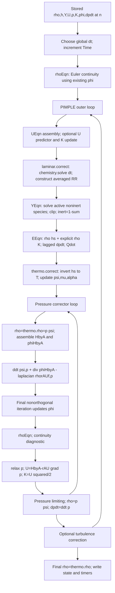

# Source-level baseline audit

Inspected 2026-10-06. Installed `/opt/OpenFOAM/OpenFOAM-v2012`, API 2012,
patch 0, OpenCFD branch, DP scalars, 32-bit labels, GCC 6.3 optimized build.
The repository contains reactingFoamTimed and reactingFoamPAD; the published
action histories use the latter and its separate restart/initial-state builds.
The present source snapshot is taken from `build/initialStateSolver` without
rebuilding or editing that input. Source hashes and the instrumentation diff
are recorded in this project's docs. Initial Git status was not clean:
`cases/`, `scripts/`, `solvers/` and `research/physics-aware-decomposition/`
were already untracked. No pre-existing files are removed or staged.

Loop-back arrows are conditional on the configured corrector counts. The
moving diagnostic has momentumPredictor=no, one outer loop, zero extra
nonorthogonal loops, unity equation relaxation, no fvOptions or MRF,
and laminar transport. Species and hs convection are common upwind;
global Euler time stepping and linear tolerances 1e-14 are inherited.

| Quantity | Actual source and operation |
|---|---|
| Chemistry | Installed `src/combustionModels/laminar/laminar.C:85` calls chemistry.solve(dt). StandardChemistryModel.C:695–758 integrates local concentrations/T internally, and returns RR=(c_end-c_start)W/dt; it does not directly overwrite transported Y/T. |
| Heat source | StandardChemistryModel.C:547–580 sets Qdot=-sum Hc_i RR_i. Repository costOde preserves the same source construction; Stuttgart moves chemistry jobs and returns RR to owner cells. There is no distinct Sh source in the selected EEqn. |
| Species | Local YEqn solves rho Yi with muEff diffusion; clipping and algebraic inert closure happen after solves. It does not renormalize every species by sumY. |
| Thermo | hePsiThermo.C:198–211 invokes calculate(...,false). At fixed solved hs and current Y it updates T,psi,mu,alpha, without updating old times. hc() evaluates formation enthalpy of the current mixture, independently of the solved hs. |
| Density | rhoEqn solves continuity before the outer loop and inside each pressure pass; pEqn replaces rho from thermo at entry and after U correction; main replaces it once more before output. These are distinct state operations. |
| Compressibility | psi is a thermo-owned field. ddt(psi,p) uses previous psi; lazy oldTime allocation made the initial coefficient vulnerable to the first thermo update. The initialization-only input preallocates initial psi.oldTime. |
| Pressure work | dpdt is read/restored on opted-in static restarts, initialized with fvc::ddt(p), and updated after every pressure pass. For one outer loop EEqn consumes the previous step's dpdt. |
| K | createK initializes 0.5 magSqr(U); UEqn updates it only if momentumPredictor is enabled; every pressure pass updates it after correcting U. |
| phi | compressibleCreatePhi reads a stored flux if present, otherwise constructs it from rho U. The final nonorthogonal pressure pass changes phi; later energy transport sees the new flux only in a subsequent outer loop or timestep. |

The selected thermoType is hePsiThermo/reactingMixture/sutherland/janaf/
sensibleEnthalpy/perfectGas. OpenFOAM hs=Ha-Hc and Hc=Ha(Tstd) per species;
`E=sum rho V(hs+hc+K)-sum pV`. `he` is not total energy. Exact installed
constants matter: R=8314.47006650545 J/(kmol K), Tstd=298.15 K and CHEMKIN
atomic weights H=1.00797, O=15.99940, N=14.00670 kg/kmol. A modern universal
gas constant would introduce a false initial mass offset of about 9e-7.

## Restart and previous evidence

heThermo normally initializes hs from T/Y rather than the saved solved hs.
The prior opt-in restart restores hs and dpdt and preallocates psi history;
Euler's previous coefficient is necessary for equivalence. The initialized
state solver additionally preallocates psi at time zero. A separate previous
mesh-migration defect lost cyclic flux copies; no mesh redistribution is
performed here. The new audit must compare ledger on/off and the unchanged
initialization-only executable, and separately test segmented restarts.

The published 240 μs moving history has mass 5.914511201018849e-8 kg,
initial energy 0.017496612061541128 J, final energy 0.01445418572091591 J,
signed normalized drift -0.17388659758380884 for dt=2 μs and one pressure
corrector. Its finest combined dt/pressure control has -0.013692172211380298
drift. Those data motivate this project but are not its measured results.

## Current versions, inspected independently

Official releases current on the audit date are OpenCFD v2606 and Foundation
14 ([OpenCFD history](https://www.openfoam.com/download/release-history),
[Foundation release](https://openfoam.org/release/14/)). Full selected sources
are retained in sourceAudit with URL/member hashes.

v2606 reactingFoam EEqn retains explicit ddt(rho,K), div(phi,K), and -dpdt for
hs; compared with v2012 it adds MRF pressure-flux work when MRF is active.
v2606 rhoPimpleFoam uses the same energy structure without reaction Qdot.
Foundation 14's multicomponentFluid uses species divj, energy divq and a
pressureWork wrapper while retaining explicit kinetic terms and hs -dpdt.
Different transport and modular coupling mean the v2012 measured attribution
cannot be generalized to Foundation 14 without new runs. The requested
Foundation pressureCorrector path was unavailable (404), recorded explicitly.

Sources: [v2606 source archive](https://dl.openfoam.com/source/v2606/),
[Foundation 14 thermophysical predictor](https://github.com/OpenFOAM/OpenFOAM-14/blob/master/applications/modules/multicomponentFluid/thermophysicalPredictor.C).
