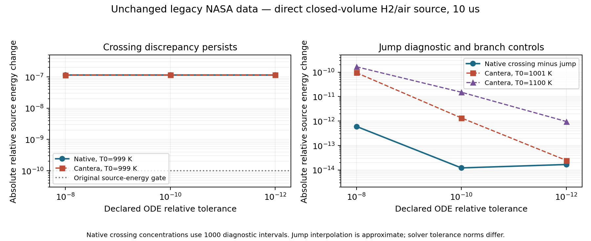

# Source energy invariance and legacy NASA branch discontinuity

The corrected Cv source satisfies its continuous energy identity on
smooth thermodynamic branches. The original 1e-10 relative accepted-source
energy gate nevertheless fails in three of four spatial Cv cases.
Final CFD energy conservation does not make this source gate pass.
The original threshold and all failed traces remain retained.

## Spatial endpoint audit

| Closure | dt (us) | Calls | Calls straddling 1000 K | Straddling failures | Other failures | Max relative source E change |
|---|---:|---:|---:|---:|---:|---:|
| none | 2 | 30720 | 144 | 144 | 7 | 2.76094831e-07 |
| conservativeState | 2 | 30720 | 0 | 0 | 0 | 9.77861216e-15 |
| none | 1 | 61440 | 184 | 184 | 8 | 2.95255564e-07 |
| conservativeState | 1 | 61440 | 240 | 240 | 0 | 3.28292948e-07 |

All 568 straddling calls exceed the unchanged gate. The 15 other
baseline failures are also retained; endpoint non-straddling does not
exclude an internal excursion, and no complete cause is asserted for
those calls. The spatial trace lacks crossing concentrations, so its
energy changes are not retrospectively identified as exact branch jumps.

## Independent thermodynamic coefficients

| Species | High-minus-low molar enthalpy at 1000 K (J/kmol) | Specific jump (J/kg) |
|---|---:|---:|
| H2 | +2.52953894 | +1.25476896 |
| H | +0 | +0 |
| O2 | +7.16845894 | +0.224022743 |
| O | +8.2427716 | +0.515192544 |
| OH | -3.81994469 | -0.224605256 |
| HO2 | -1.50076184 | -0.0454683038 |
| H2O2 | +26.8169375 | +0.788391664 |
| H2O | +14.6312501 | +0.812155092 |
| AR | +0 | +0 |
| N2 | -0.445101302 | -0.0158888711 |

The perfect-gas R*T term is continuous, so internal energy has the same
branch jump. On each smooth branch, dE/dt=0 follows from the Cv RHS;
a discontinuous polynomial energy includes an additional signed jump
sum_s c_s Delta h_s. The smooth-branch RHS alone does not supply it.

## Direct native and independent source controls

p=101325 Pa; Y_H2=.0283, Y_O2=.225, Y_H=Y_OH=.0001, N2=.7465;
TF=10 us; unchanged legacy mechanism, matched molecular weights and
constants. Native Rosenbrock34 is compared with independent Cantera
IdealGasReactor/BDF, clone=False. The native probe also subdivides
the source into 1000 equal diagnostic intervals, interpolating
concentrations at the detected switch. This is an approximate jump
diagnostic, not an event-exact integrator or new CFD method.

| Initial T (K) | rtol | Native E change (relative) | Jump-subtracted native remainder (relative) | Cantera E drift (relative) | Native/Cantera T difference (K) |
|---:|---:|---:|---:|---:|---:|
| 999 | 1e-08 | 1.14605116e-07 | 6.03226461e-13 | +1.14481535e-07 | 3.35793243e-06 |
| 999 | 1e-10 | 1.14604525e-07 | 1.21701109e-14 | +1.14602151e-07 | 3.60571448e-08 |
| 999 | 1e-12 | 1.14604496e-07 | 1.67651885e-14 | +1.14604332e-07 | 3.26281224e-09 |
| 1001 | 1e-08 | 2.81861104e-15 | 2.81861104e-15 | -9.42653598e-11 | 2.53926464e-06 |
| 1001 | 1e-10 | 3.87559018e-15 | 3.87559018e-15 | -1.33954610e-12 | 3.21308562e-08 |
| 1001 | 1e-12 | 1.51500343e-14 | 1.51500343e-14 | -2.46628687e-14 | 7.37827577e-10 |
| 1100 | 1e-08 | 5.49504132e-14 | 5.49504132e-14 | -1.65259238e-10 | 4.24164500e-06 |
| 1100 | 1e-10 | 1.10229871e-14 | 1.10229871e-14 | -1.50755113e-11 | 3.62733317e-07 |
| 1100 | 1e-12 | 1.05294205e-14 | 1.05294205e-14 | -9.58836212e-13 | 1.24421149e-08 |

The crossing energy change remains about 1.14605e-7 as the native ODE
tolerance tightens. At rtol1e-10/1e-12 the fine diagnostic jump estimate
leaves less than 1.7e-14 relative unexplained energy. Above-branch
native controls stay below 1.5e-13. Independent Cantera retains the
same positive crossing change; the strict native/Cantera temperature
difference there is below 3.3e-9 K. Molar jumps from native properties
and independently evaluated NASA coefficients agree within 5.72e-8
J/kmol. This isolates the data/RHS compatibility limitation in these
direct controls; it is not an OpenFOAM-only invariant failure.

[Exported PDF figure](../figures/candidates/chemistry_branch_invariant.pdf)

## Conservative inversion counterexamples

Actual-data balanced H2/air has an admissible conservative target inside a 0.074071648 J/kg energy gap.
Exact rational natural interval bounds certify positive branch Cv
over 200–5000 K, but no valid temperature root exists for that target.
This is an algebraic possible state, not an integrated reaction path.

Pure N2 instead has a 0.015888871 J/kg overlap, with valid roots
999.999990896791 and 1000.000009103200 K.
Both branch temperatures, pressures and energies are admissible.
Positive branch Cv does not guarantee global invertibility. See
[the derivation](candidates/thermoBranchInversion.md) and
thermo_branch_inversion.json for certificates and exact inputs.

## Decision and limits

Retain the failed spatial source gate. Do not alter accepted thermo
coefficients, replace the source-energy cutoff or declare a conservative
reacting method validated from final inventory alone. The roughly 1e-7
source jump is distinct from the original order-1e-1 CFD density-pair
loss. It does not explain the original loss or remove coarse quenching.

[Cantera NasaPoly2 validation](https://www.cantera.org/3.2/cxx/d6/de1/NasaPoly2_8cpp_source.html)
already checks midpoint Cp/enthalpy/entropy discontinuities. Warning
thresholds do not enforce exact continuity. Polynomial validation or
repair is an established practice, not a new numerical-method contribution.

Raw CvBranchProbe and cantera_Branch directories retain source snapshots,
library/executable hashes, exact inputs and trajectories. Processed
cv_source_invariant_audit.json, cv_branch_probe.json and
cantera_branch_probe.json are the table sources. Continuous identity
and homogeneous 1100 K claims remain restricted to their tested branch.
